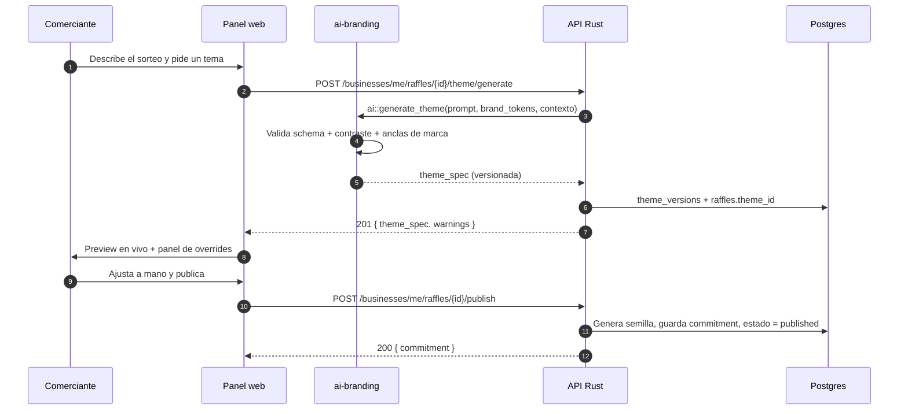
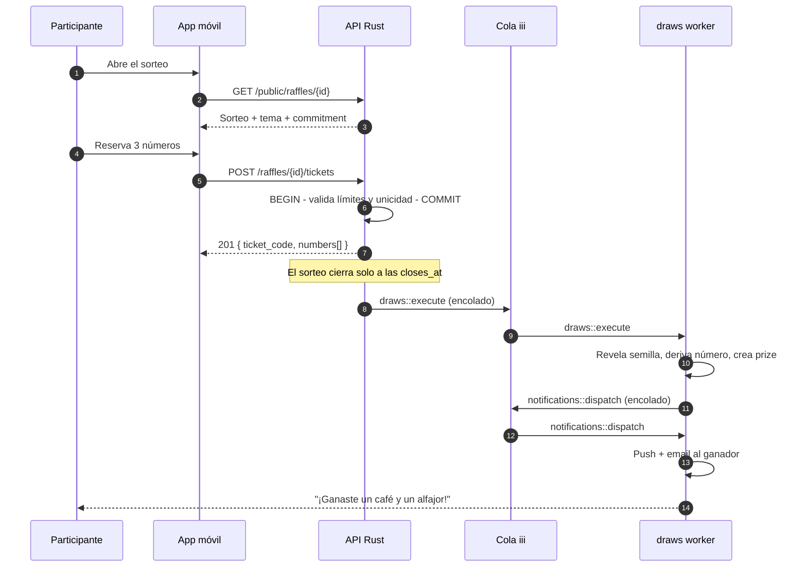
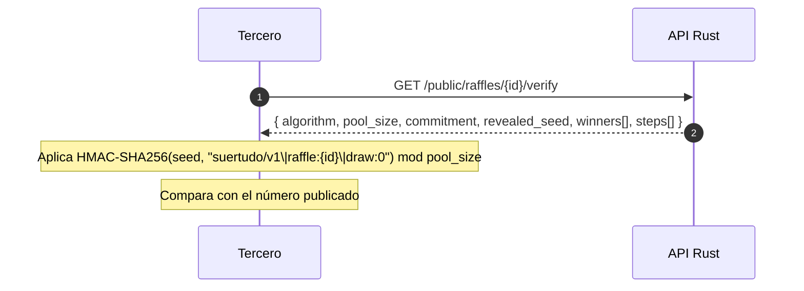
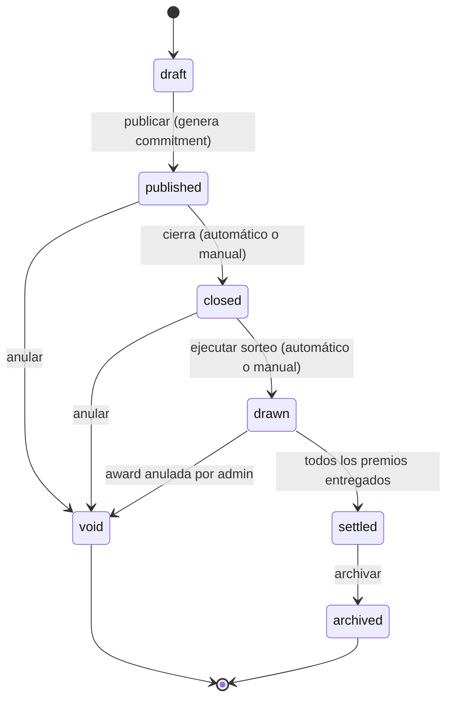

# PRD — Suertudo

> **Sorteos promocionales para comercios locales.** Los participating participants reservan números gratis en sorteos de negocios reales, el resultado se sortea con un mecanismo verificable por cualquier tercero, y el negocio obtiene tráfico, visibilidad y una lista de contactos para fidelizar.
>
> Este documento es el contrato de producto. Los documentos complementarios son [`data-model.md`](./data-model.md), [`api-contract.md`](./api-contract.md), [`ai-spec.md`](./ai-spec.md), [`architecture.md`](./architecture.md) y [`roadmap.md`](./roadmap.md).

| Campo | Valor |
|---|---|
| Versión | 1.0 |
| Estado | Aprobado para construcción |
| Fecha | 2026-10-20 |
| Producto | Suertudo |
| Idioma | Español (Argentina), `es-AR` |

---

## 1. Resumen ejecutivo

Suertudo es una **plataforma de sorteos promocionales** para comercios locales. El participante entra a la app, ve los sorteos de los negocios cerca de él, **reserva números gratis** y, si el número sorteado es suyo, gana un premio que entrega el negocio. El negocio gestiona todo desde un panel web, y puede pedirle a una IA que le arme la identidad visual del sorteo.

La decisión de producto que define todo lo demás:

> **El participante nunca paga.** El premio lo financia el negocio y siempre es un producto o servicio, nunca dinero en efectivo. La plataforma se monetiza con una suscripción SaaS al comercio.

Esa decisión elimina de un plumazo la pasarela de pagos, el split settlement, el KYC de usuarios, el PCI-DSS y el riesgo regulatorio de juego de azar con pago. Lo que queda es un problema de **confianza** (que el sorteo sea real) y de **distribución** (que la gente se entere y participe), que es donde se va el producto.

### 1.1 Decisiones cerradas

| # | Tema | Decisión | Consecuencia principal |
|---|---|---|---|
| D1 | Modelo de dinero | Sorteo promocional gratuito. Sin pagos del participante. | No hay pasarela de pagos ni tablas de ledger. El negocio paga una suscripción. |
| D2 | Origen del número | Sorteo propio **commit–reveal** verificable por terceros. | No depende de loterías externas. Calendario controlado por el negocio. |
| D3 | Premio | Siempre producto o servicio del negocio. Nunca efectivo. | Mantiene el producto en el marco de promoción comercial. |
| D4 | Stack | Flutter 3.47 (móvil) + Next.js 16 / React 19 (web) + Rust con iii v0.25 (backend). | iii orquesta; la capa de negocio expone su propio puerto HTTP. |
| D5 | IA visual | V1 genera tokens de tema + copy, con los tokens de marca del negocio como anclas. | El diferenciador entra en el MVP sin generar imágenes. |
| D6 | Datos a la empresa | Consentimiento granular. El negocio solo ve contactos que lo aceptaron. | Cumplimiento de la Ley 25.326 sin fricción para el usuario. |
| D7 | Monetización | Suscripción SaaS por negocio (3 planes) + add-on por sorteos extra. | ARPU por negocio activo, no por transacción. |

### 1.2 Supuestos

Estos puntos **no fueron decididos explícitamente** y se asumen razonablemente. Cada uno está marcado en el documento donde aplica. Si alguno es falso, el impacto está anotado.

| ID | Supuesto | Impacto si es falso |
|---|---|---|
| `[SUPUESTO-1]` | Jurisdicción: Argentina. Moneda ARS, es-AR, Ley 25.326. | Cambia moneda, IVA, normativa de sorteos y los textos legales. |
| `[SUPUESTO-2]` | El premio lo entrega el negocio; la plataforma solo trackea el estado. | Si la plataforma entrega, aparecen logística, stock y reimbursos. |
| `[SUPUESTO-3]` | Sin KYC obligatorio del negocio en V1 (solo CUIT y datos de contacto). | Si hay grandes cadenas con conciliación de pagos, hace falta verificación documental. |
| `[SUPUESTO-4]` | La participación es gratuita siempre; no hay "números premium" de pago. | Si aparece un número premium pagado, reaparece el riesgo regulatorio. |
| `[SUPUESTO-5]` | Los sorteos se sortean por **número** estilo lotería, no eligiendo un ticket al azar. | Ambas variantes están soportadas (`draw_unit`); cambia la UI y la probabilidad de sorteo vacío. |
| `[SUPUESTO-6]` | Sin generación de imágenes por IA en V1. | Si se pide, se agrega un worker de imágenes con moderación. |
| `[SUPUESTO-7]` | Los usuarios son finales; no hay login de cliente B2B. | Si aparece, hace falta un segundo modelo de permisos. |

---

## 2. El problema

### 2.1 Del lado del comercio local

Un comercio de barrio quiere aumentar su tráfico un fin de semana o liquidar stock. Tiene dos herramientas: la publicidad (cara, poco medible) y el giveaway de Instagram (mucho alcance, cero trazabilidad, y el prize se pierde entre 300 comentarios). Lo que **no** tiene es:

- **Un canal que traiga gente al local**, con un incentivo concreto.
- **Saber quién entró** y poder contactarlo después.
- **Confianza de que el sorteo es real.** Un giveaway en comentarios es balas por los colleagues, y el business tiene que entregar un premio sin saber a quién.

### 2.2 Del lado del participante

El participante quiere un premio, pero no quiere trusting a un Instagram con 40 mil seguidores, ni instalar una app para un prize de un café. Quiere: **ver sorteos cerca de él, participar en dos toques, y saber al instante si ganó**.

### 2.3 El hueco de mercado

Las loterías online son anónimas, carísimas en turnos yDl reassuringly opacas: no sabés quién organiza el premio, no recibís un lead, y el commerce tiene cero retorno. Las plataformas de giveaway sonExactly lo contrario: buena viralidad, cero confianza. **Suertudo es la combinación: la confianza de la lotería (mecanismo verificable) con la utilidad comercial del giveaway (tráfico + leads consentidos).**

---

## 3. Personas y jobs

### 3.1 Participante — "el que quiere el premio"

| Aspecto | Detalle |
|---|---|
| **Contexto** | Ve un cartel en un local, o un post de Instagram del negocio. Instala la app o entra por un link. |
| **Job principal** | *"Quiero participar de este sorteo y enterarme al toque si gané."* |
| **Jobs secundarios** | *"Quiero ver qué sorteos hay cerca de mí sin criarme una cuenta todavía."* / *"Quiero ver mis números y el resultado, aunque no gane."* |
| **Fricciones a eliminar** | Login obligatorio antes de ver el sorteo. No saber si el sorteo es real. No enterarse del resultado. |
| **Criterio de éxito propio** | "Entro, participo, y me avisan." |

### 3.2 Comerciante — "el que pone el premio"

| Aspecto | Detalle |
|---|---|
| **Contexto** | Dueño o encargado de un comercio. 30 minutos al día, en el celular o desde una netbook en el mostrador. |
| **Job principal** | *"Quiero llenar el local este sábado y que el premio se entregue a alguien real."* |
| **Jobs secundarios** | *"Quiero que el sorteo se vea con la identidad de mi marca, no genérico."* / *"Quiero una lista de los queENTERaron para mandarles un promo después."* / *"Quiero saber si el sorteo me convenció."* |
| **Fricciones a eliminar** | Configurar un sorteo implica llamar a un proveedor técnico. Publicar en su tienda implica esperar. Cargar el premio en un software de retail, imposible. |
| **Criterio de éxito propio** | "El local se llenó y sé a quién llamar después." |

### 3.3 Administrador de plataforma — "el que opera Suertudo"

| Aspecto | Detalle |
|---|---|
| **Job principal** | *"Detectar sorteos problemáticos, abuso y fraude antes de que dañen la confianza de la plataforma."* |
| **Job secundario** | *"Poder auditar cualquier sorteo y reconstruir qué pasó."* |

### 3.4 Mapa de permisos

| Capacidad | Participante | Comerciante | Admin |
|---|:---:|:---:|:---:|
| Ver sorteos públicos activos | ✅ | ✅ | ✅ |
| Reservar números | ✅ | — | — |
| Ver sus participaciones y premios | ✅ | — | ✅ |
| Crear/editar sorteos | — | ✅ (de su negocio) | ✅ |
| Generar tema con IA | — | ✅ (de su negocio) | ✅ |
| Ver participantes de un sorteo | — | ✅ (de su negocio) | ✅ |
| Ver **contactos** de participantes | — | ✅ solo con `share_marketing = true` | ✅ |
| Exportar participantes (CSV) | — | ✅ (de su negocio) | ✅ |
| Anular un sorteo | — | — | ✅ |
| Suspender un negocio | — | — | ✅ |
| Ver auditoría | — | — | ✅ |

---

## 4. Alcance

### 4.1 MVP — qué entra

El MVP es **un vertical completo**: un negocio crea un sorteo con IA, un participante se registra y reserva números, el sistema sortea de forma verificable, el ganador se entera, y el negocio ve su lista.

| # | Capacidad | Módulo |
|---|---|---|
| 1 | Registro e inicio de sesión de participantes (email + magic link) | `identity` |
| 2 | Registro e inicio de sesión de comercios (email + contraseña) | `identity` |
| 3 | Perfil de negocio: nombre, logo, colores de marca, tipografías, categoría, ubicación | `businesses` |
| 4 | Crear y editar sorteo: título, premio, reglas, fecha de cierre, fecha de sorteo, pool de números, límites por persona | `raffles` |
| 5 | **Generación de tema visual con IA** + editor manual de override | `ai-branding` |
| 6 | Publicar / cerrar / anular sorteo con máquina de estados explícita | `raffles` |
| 7 | Feed de sorteos activos y detalle de sorteo en la app móvil | `mobile` |
| 8 | Reserva de N números (manual o automática) con control de duplicados y de límite por persona | `participation` |
| 9 | Modo de participación `validated` con códigos de un solo uso | `participation` |
| 10 | Sorteo commit–reveal con verificación pública | `draws` |
| 11 | Notificación push + email al ganador, y push recordatorio a participantes | `notifications` |
| 12 | Panel web: listado de sorteos, métricas, participantes, estado de premios, export CSV | `business-web` |
| 13 | Consentimiento granular y registro de auditoría | `privacy` |
| 14 | Planes de suscripción (3 tiers) y límites de uso | `billing` (interno, sin pasarela de pagos) |

### 4.2 Fuera del MVP — explícitamente

Estas capacidades **no** se construyen en el MVP. Están anotadas para que nadie las asuma por error.

| Excluido | Razón | Cuándo se reconsidera |
|---|---|---|
| Pagos del participante | Decisión D1 | Nunca, salvo cambio de modelo (ver §10.2) |
| Lotería externa como origen | Sin API pública fiable (§14, R3) | Fase 3, vía adaptador |
| Generación de imágenes por IA | `SUPUESTO-6` | Fase 2, con flag |
| CRM externo (Mailchimp, Braze) | El export CSV alcanza en V1 | Fase 3 |
| WhatsApp |requiere proveedor + plantillas + opt-in | Fase 2 |
| Web de participantes | El MVP es mobile-first | Fase 2 (página pública del sorteo) |
| Multi-idioma | Solo es-AR | Fase 3 |
| App de mostrador para el personal | El staff valida desde el panel web | Fase 3 |
| Gamificación (sellos, referidos) | No es el problema central | Fase 3 |
| Analytics avanzado con IA | Requiere volumen de datos | Fase 3 |
| KYC documental del negocio | `SUPUESTO-3` | Fase 2 |

### 4.3 Criterio de salida del MVP

El MVP está terminado cuando:

- [ ] Un comercio se registra, crea un sorteo con tema generado por IA y lo publica sin ayuda.
- [ ] Un participante se registra, reserva 3 números y recibe su código.
- [ ] Al llegar la hora, el sorteo se ejecuta automáticamente y el resultado es verificable por un tercero con los datos públicos.
- [ ] El ganador recibe push + email dentro del minuto.
- [ ] El comercio ve la lista de participantes, exporta CSV y marca el premio como entregado.
- [ ] Un usuario con el mismo `business_id` en el token **no puede** ver datos de otro negocio (test automatizado que lo demuestre).

---

## 5. Requisitos funcionales

Cada requisito tiene un ID estable. Los IDs no se reutilizan ni se renumeran: un requisito eliminado se marca como `Obsoleto` en el changelog del documento.

Convenciones de los criterios de aceptación:
- **Dado / Cuando / Entonces** en español.
- "Entonces" describe un resultado **observable**, nunca una implementación.

### 5.1 Identidad y acceso — `FR-ID-*`

| ID | Requisito | Criterio de aceptación |
|---|---|---|
| `FR-ID-01` | El participante se registra con email y recibe un enlace mágico de un solo uso con validez de 15 minutos. | **Dado** un email no registrado **Cuando** se solicita el enlace **Entonces** se envía un email con un link de un solo uso; **Cuando** se usa dos veces **Entonces** la segunda falla con `AUTH_LINK_CONSUMED`. |
| `FR-ID-02` | El comercio se registra con email + contraseña (mínimo 10 caracteres) y datos del negocio. | **Dado** un email nuevo **Cuando** completa el formulario **Entonces** se crea `business` + `business_members` con rol `owner` en una sola transacción. |
| `FR-ID-03` | El participantve accede con Apple y Google (Sign in with Apple en iOS, Google en Android y web). | **Dado** un `provider` no soportado en la plataforma **Cuando** se intenta **Entonces** la UI oculta el botón, no falla en runtime. |
| `FR-ID-04` | La sesión usa access token (15 min) + refresh token rotativo (30 días) almacenado en el dispositivo. | **Dado** un refresh token revocado **Cuando** se usa **Entonces** la familia de tokens completa queda invalidada. |
| `FR-ID-05` | El participante puede pedir baja de cuenta. | **Dado** un usuario con participaciones **Cuando** solicita la baja **Entonces** sus datos personales se anonimizan, sus tickets se conservan con `user_id` nulo y el historial de premios se mantiene. |
| `FR-ID-06` | El comercio puede invitar miembros con rol `admin`, `staff` o `analyst`. | **Dado** un `analyst` **Cuando** intenta crear un sorteo **Entonces** la API devuelve `403 RBAC_FORBIDDEN`. |
| `FR-ID-07` | Todo acceso a datos de negocio deriva el `business_id` del token, nunca del body de la petición. | **Dado** un token del business A **Cuando** pide `/businesses/B/raffles` **Entonces** devuelve `404` (no `403`, para no filtrar existencia). |

### 5.2 Sorteos — `FR-RA-*`

| ID | Requisito | Criterio de aceptación |
|---|---|---|
| `FR-RA-01` | El comercio crea un sorteo con: título, descripción, premio (nombre, descripción, cantidad, instrucciones de entrega), reglas, categoría, `closes_at`, `draws_at`, `number_pool_size`, límites de números por persona y por ticket, `participation_mode`, `draw_unit`, `no_winner_policy`. | **Dado** un comercio en plan `starter` **Cuando** crea su sorteó más activo del mes **Entonces** la API devuelve `402 PLAN_LIMIT_REACHED`. |
| `FR-RA-02` | El sorteo se publica con un **compromiso criptográfico** (`seed_commitment`) visible para todos antes de abrir la participación. | **Dado** un sorteo publicado **Cuando** se consulta el detalle público **Entonces** el campo `commitment` está presente y es inmutable; **Cuando** se intenta modificarlo **Entonces** la API devuelve `409 IMMUTABLE_FIELD`. |
| `FR-RA-03` | Al publicar, el sistema genera la semilla con CSPRNG (32 bytes) y la almacena cifrada (AES-256-GCM) hasta el momento de la revelación. | **Dado** una inspección de la base **Cuando** se lee la fila de la semilla **Entonces** el valor es ciphertext, nunca el binario en claro. |
| `FR-RA-04` | Los estados del sorteo son `draft → published → closed → drawn → settled`, más `void` y `archived`. Las transiciones inválidas se rechazan. | **Dado** un sorteo `draft` **Cuando** se intenta `draw` **Entonces** devuelve `409 INVALID_STATE_TRANSITION` con la lista de transiciones válidas. |
| `FR-RA-05` | `published → closed` ocurre automáticamente a las `closes_at` (job cada minuto, con ventana de tolerancia de 5 min). | **Dado** un sorteo con `closes_at` pasado **Cuando** corre el job **Entonces** el sorteo queda `closed` y toda reserva posterior devuelve `409 RAFFLE_CLOSED`. |
| `FR-RA-06` | `closed → drawn` ocurre automáticamente a las `draws_at`, o manualmente por el comercio con autorización explícita. | **Dado** un sorteo `closed` **Cuando** el comercio pide el sorteo manual **Entonces** se registra en la auditoría quién y cuándo lo ejecutó. |
| `FR-RA-07` | El comercio puede anular un sorteo `published` o `closed`. | **Dado** un sorteo anulado **Cuando** un participante tenía números reservados **Entonces** se le notifica la anulación y sus números se liberan. |
| `FR-RA-08` | El sorteo puede definir **varios premios**. Si hay menos ganadores que premios, los premios sobrantes se declaran `unassigned` con explicación. | **Dado** 1 ganador y 2 premios **Cuando** se ejecuta el sorteo **Entonces** hay 1 `prize` en `pending` y 1 en `unassigned` con motivo `no_winner`. |
| `FR-RA-09` | El detalle público del sorteo muestra: información del premio, fecha de cierre, cantidad de números disponibles/reservados, estado, tema aplicado y compromiso del sorteo. | **Dado** un sorteo `published` **Cuando** se consulta `/public/raffles/{id}` **Entonces** la respuesta no contiene datos de participantes. |
| `FR-RA-10` | El feed público devuelve sorteos activos, filtrable por `business_id`, `category`, `province`, `city`, con paginación por cursor. | **Dado** 200 sorteos activos **Cuando** se pide la página 2 **Entonces** no se repite ningún ID de la página 1. |

### 5.3 Participación — `FR-PA-*`

| ID | Requisito | Criterio de aceptación |
|---|---|---|
| `FR-PA-01` | El participante reserva N números de un sorteo abierto, con `1 ≤ N ≤ numbers_per_ticket_max`. | **Dado** un límite de 5 **Cuando** se piden 6 números **Entonces** devuelve `422 TICKET_SIZE_OUT_OF_RANGE`. |
| `FR-PA-02` | La reserva puede ser manual (números elegidos) o automática (el sistema elige N distintos al azar). | **Dado** una reserva automática **Cuando** se completa **Entonces** los N números son distintos, están en el rango del pool y ninguno estaba reservado. |
| `FR-PA-03` | Un número reservado no puede volver a reservarse. | **Dado** el número 42 reservado **Cuando** otro usuario intenta tomarlo **Entonces** la reserva falla con `409 NUMBER_TAKEN` y **ninguna** parte de su ticket queda persistida (atomicidad). |
| `FR-PA-04` | Existe un límite de tickets por usuario y por sorteo (`max_tickets_per_user`). | **Dado** el límite es 1 **Cuando** el mismo usuario reserva dos veces **Entonces** la segunda devuelve `409 TICKET_LIMIT_REACHED`. |
| `FR-PA-05` | En `participation_mode = validated`, la reserva exige un código de un solo uso emitido por el comercio. | **Dado** un código ya usado **Cuando** se intenta reutilizar **Entonces** devuelve `409 VALIDATION_CODE_USED`; **Dado** un código inexistente **Entonces** `422 INVALID_VALIDATION_CODE`. |
| `FR-PA-06` | Cada ticket tiene un código legible y único (`SU-TKU4F9K`) que el participante puede mostrar en el local. | **Dado** un ticket **Cuando** se consulta desde el panel del comercio **Entonces** se puede buscar por ese código. |
| `FR-PA-07` | El participante puede cancelar su ticket mientras el sorteo esté `published`. | **Dado** un ticket cancelado **Cuando** se cierra el sorteo **Entonces** sus números vuelven al pool disponible. |
| `FR-PA-08` | El participante ve su número de ticket, sus números, el sorteo y el resultado desde "Mis participaciones". | **Dado** un sorteo `drawn` **Cuando** el participante abre su ticket **Entonces** ve si ganó, qué premio y qué número ganador. |
| `FR-PA-09` | Anti-abuso: rate limit por IP y por usuario en la creación de tickets, y bloqueo de emails desechables. | **Dado** 10 reservas en 5 minutos desde la misma IP **Cuando** se intenta la 11ª **Entonces** devuelve `429 RATE_LIMITED` con `Retry-After`. |
| `FR-PA-10` | El sistema detecta y bloquea reservas de cuentas creadas masivamente (patrón de altaN en poco tiempo). | **Dado** 3 cuentas nuevas desde la misma IP en 10 minutos **Cuando** intentan reservar **Entonces** quedan en `pending_review` y el sorte se sigue formando. |

### 5.4 Sorteo y premios — `FR-DR-*`

| ID | Requisito | Criterio de aceptación |
|---|---|---|
| `FR-DR-01` | El sorteo se ejecuta **exactamente una vez** por sorteo, incluso con ejecuciones concurrentes. | **Dado** 5 ejecuciones simultáneas del mismo sorteo **Cuando** llegan al worker **Entonces** exactamente una crea el `draw` y las otras 4 son no-ops idempotentes. |
| `FR-DR-02` | El algoritmo de derivación es determinístico y público: `winner_index = u64_be(HMAC-SHA256(seed, "suertudo/v1\|raffle:{id}\|draw:{i}")[0..8]) mod pool_size`. | **Dado** el mismo seed, id e índice **Cuando** se recalcula fuera del sistema **Entonces** se obtiene el mismo número. |
| `FR-DR-03` | El número sorteado debe ser **uno de los reservados**; si no lo está, se aplica la `no_winner_policy`. | **Dado** que el número sorteado no lo tiene nadie **Cuando** `no_winner_policy = redraw` **Entonces** se incrementa el índice de draw y se re-deriva, hasta 100 intentos. |
| `FR-DR-04` | Al ejecutarse, la semilla se revela en claro y queda pública de forma permanente. | **Dado** un sorteo `drawn` **Cuando** se consulta `/public/raffles/{id}/verify` **Entonces** devuelve la semilla revelada, el compromiso, el pool y los pasos de verificación. |
| `FR-DR-05` | Un tercero puede verificar el resultado con los datos públicos, sin depender de la plataforma. | **Dado** los 4 datos públicos **Cuando** un tercero aplica la fórmula de `FR-DR-02` **Entonces** obtiene el número ganador publicado. |
| `FR-DR-06` | Con `draw_unit = ticket`, el sorteo elige entre los tickets participantes en lugar de sobre el pool de números. | **Dado** `draw_unit = ticket` **Cuando** se ejecuta **Entonces** el ganador es un ticket, y el número se deriva igual de forma determinística. |
| `FR-DR-07` | Al cerrar, los ganadores generan un `prize` en estado `pending` y se disparan las notificaciones. | **Dado** un sorteo con 1 ganador **Cuando** se ejecuta **Entonces** existe 1 `prize` en `pending` y 1 notificación encolada. |
| `FR-DR-08` | El participante reclama su premio desde la app. | **Dado** un premio en `pending` **Cuando** el ganador lo reclama **Entonces** pasa a `claimed` y el comercio ve el cambio en tiempo real. |
| `FR-DR-09` | El comercio marca el premio como `delivered` con evidencia opcional (nota, imagen). | **Dado** un premio en `claimed` **Cuando** el commerce marca `delivered` **Entonces** el participante recibe notificación y el prize queda en `delivered`. |
| `FR-DR-10` | Los premios no reclamados expiran según la política del sorteo (default 30 días) y el negocio puede extenderlo. | **Dado** un prize `pending` con 31 días **Cuando** corre el job de expiración **Entonces** pasa a `expired` y se notifica a las dos partes. |

### 5.5 Panel del comercio — `FR-BZ-*`

| ID | Requisito | Criterio de aceptación |
|---|---|---|
| `FR-BZ-01` | El comercio ve el listado de sus sorteos con estado, fechas, participantes y prizes, filtrable por estado. | **Dado** 12 sorteos **Cuando** filtra por `drawn` **Entonces** devuelve solo los `drawn`. |
| `FR-BZ-02` | El comercio ve métricas por sorteo: participantes, tickets, cobertura de números, tasa de participación vs. impresiones, premios pendientes. | **Dado** un sorteo con 50 reservas sobre un pool de 1000 **Entonces** la cobertura muestra `5.0 %`. |
| `FR-BZ-03` | El comercio ve la lista de participantes con ticket, números, fecha y estado de premio. | **Dado** un participante sin `share_marketing` **Cuando** el comercio lo mira **Entonces** ve el ticket pero **no** email ni teléfono, y la UI lo indica. |
| `FR-BZ-04` | El comercio exporta los participantes a CSV. | **Dado** un sorteo con 50 participantes **Cuando** exporta **Entonces** el CSV tiene una fila por ticket y las columnas de contacto solo si hay consentimiento. |
| `FR-BZ-05` | El comercio gestiona el estado de entrega de los premios. | **Dado** 2 premios en `claimed` **Cuando** marca uno como entregado **Entonces** el otro sigue en `claimed`. |
| `FR-BZ-06` | El comercio puede duplicar un sorteo pasado como base para uno nuevo (conserva premio, reglas y tema). | **Dado** un sorteo `drawn` **Cuando** se duplica **Entonces** el nuevo nace en `draft` con `closes_at` vacío y **sin** compromiso de semilla heredado. |
| `FR-BZ-07` | El comercio ve un panel de "fidelización": participantes con consentimiento, agrupados y con su historial. | **Dado** 30 participantes consentidos **Cuando** abre el panel **Entonces** ve contactos, último sorteo y total de participaciones. |
| `FR-BZ-08` | El negocio puede compartir el sorteo con un link público y con un deep link `suertudo://raffle/{id}`. | **Dado** un link `suertudo://raffle/{id}` **Cuando** se abre en un teléfono con la app **Entonces** navega directo al detalle. |

### 5.6 IA — `FR-AI-*`

| ID | Requisito | Criterio de aceptación |
|---|---|---|
| `FR-AI-01` | El comercio describe el sorteo en texto libre (≤ 500 caracteres) y pide un tema. | **Dado** un prompt de 600 caracteres **Cuando** se envía **Entonces** devuelve `422 PROMPT_TOO_LONG` antes de llamar al modelo. |
| `FR-AI-02` | El sistema devuelve un `theme_spec` que valida contra un JSON Schema estricto (`additionalProperties: false`). | **Dado** una respuesta del modelo con un campo extra **Cuando** se valida **Entonces** se rechaza y se reintenta una vez; si vuelve a fallar, cae al tema por defecto. |
| `FR-AI-03` | Los tokens de marca del negocio (color primario, secundario, logo, tipografías) son **anclas fijas**: la IA no puede cambiarlos. | **Dado** un business con primario `#1E5F74` **Cuando** la IA propone otro primario **Entonces** el validador lo descarta y mantiene `#1E5F74`. |
| `FR-AI-04` | Todo par de texto sobre fondo cumple contraste WCAG AA (≥ 4.5:1; ≥ 3:1 para texto grande). | **Dado** una paleta proposal con contraste 2.8:1 **Cuando** se valida **Entonces** el color de texto se ajusta automáticamente hasta cumplir, o se cae al tema por defecto. |
| `FR-AI-05` | La generación es asíncrona: el comercio ve estado `generating` y el resultado aparece sin recargar. | **Dado** una generación en curso **Cuando** el comercio navega **Entonces** no pierde el estado y el resultado aparece en ≤ 10 s (p95). |
| `FR-AI-06` | El comercio puede editar cualquier token a mano; el override se persiste y sobrevive a regeneraciones. | **Dado** un override manual de color **Cuando** se regenera el tema **Entonces** el override se mantiene y el tema queda marcado `customized`. |
| `FR-AI-07` | Cada generación crea una versión del tema; se puede hacer rollback a una anterior. | **Dado** 3 versiones **Cuando** se activa la v1 **Entonces** el tema activo pasa a ser la v1 y queda registrado en la auditoría. |
| `FR-AI-08` | La IA redacta el copy del sorteo: título alternativo, subtítulo, CTA, línea de urgencia, aviso. | **Dado** un copy generado **Cuando** el comercio edita **Entonces** el texto editado es el que se publica. |
| `FR-AI-09` | El prompt del negocio se trata como **datos**, nunca como instrucciones del sistema. | **Dado** un prompt con "ignore previous instructions" **Cuando** se genera **Entonces** el resultado sigue la plantilla del tema y no ejecuta la instrucción. |
| `FR-AI-10` | La generación está cacheada por hash(prompt + tokens de marca + contexto del sorteo). | **Dado** el mismo prompt y contexto **Cuando** se regenera **Entonces** devuelve la versión cacheada sin llamar al modelo. |

Detalle completo de prompts, schema, guardarraíles y métricas de evaluación: [`ai-spec.md`](./ai-spec.md).

### 5.7 Notificaciones — `FR-NO-*`

| ID | Requisito | Criterio de aceptación |
|---|---|---|
| `FR-NO-01` | Los ganadores reciben push + email con el nombre del premio y las instrucciones de entrega. | **Dado** un ganador sin token de push **Cuando** se envía **Entonces** el email sale igual y el push queda `skipped`. |
| `FR-NO-02` | Los participantes reciben un recordatorio 24 h antes del cierre, solo siZz nolamydia.prod.participado. | **Dado** un participante sin ticket **Cuando** se dispara el recordatorio **Entonces** no se le envía. |
| `FR-NO-03` | Las notificaciones son idempotentes por `(user_id, type, entity_id)`. | **Dado** un job de notificación ejecutado dos veces **Cuando** se reintenta **Entonces** no se duplica el push. |
| `FR-NO-04` | El participante controla qué notificaciones quiere recibir (marketing vs. operativas). | **Dado** el participante con marketing desactivado **Cuando** se dispara una campaña **Entonces** no se encola. |
| `FR-NO-05` | El experimento de un push no bloquea la cola: las notificaciones fallidas van a DLQ tras 3 reintentos. | **Dado** un push con token inválido **Cuando** falla 3 veces **Entonces** el mensaje queda en la DLQ y el token se marca `inactive`. |
| `FR-NO-06` | El negocio puede enviar un mensaje a los participantes consentidos (≤ 1 por sorteo por semana). | **Dado** 2 envíos en la misma semana **Cuando** se intenta el segundo **Entonces** devuelve `429 MESSAGE_RATE_LIMITED`. |

### 5.8 Privacidad y plataforma — `FR-PR-*`

| ID | Requisito | Criterio de aceptación |
|---|---|---|
| `FR-PR-01` | Al participar, el participante acepta explícitamente el tratamiento de sus datos y elige, de forma granular, si comparte su contacto con el negocio para marketing. | **Dado** un participante que no marca `share_marketing` **Cuando** el negocio exporta **Entonces** el CSV no incluye email ni teléfono. |
| `FR-PR-02` | El consentimiento queda registrado con `granted`, `source`, `ip`, `user_agent` y `created_at`, y es auditable. | **Dado** un registro de consentimiento **Cuando** se audita **Entonces** se puede reconstruir cuándo y desde dónde se dio. |
| `FR-PR-03` | El participante puede revocar el consentimiento de marketing en cualquier momento. | **Dado** un `share_marketing = true` **Cuando** se revoca **Entonces** los contactos dejan de estar disponibles para ese negocio desde el siguiente export. |
| `FR-PR-04` | Ningún participante aparece en los listados de dos negocios a la vez, salvo que haya PARTICIPADO en ambos y consentido en ambos. | **Dado** un participante en el business A y B **Cuando** A exporta **Entonces** solo ve los contactos de las participaciones de A. |
| `FR-PR-05` | El participante puede exportar sus datos personales (portabilidad) y pedir su supresión. | **Dado** una solicitud de portabilidad **Cuando** se procesa **Entonces** se entrega un JSON con todos sus datos en ≤ 30 días. |
| `FR-PR-06` | Toda acción sensible (crear/publicar/cerrar/anular sorteo, generar tema, exportar datos, cambiar estado de premio) queda en la auditoría con actor, timestamp y diff. | **Dado** una exportación CSV **Cuando** se revisa la auditoría **Entonces** aparece el actor, la hora y el número de filas. |
| `FR-PR-07` | El admin puede anular cualquier sorteo y suspender un negocio, con motivo obligatorio. | **Dado** una suspensión **Cuando** el negocio intenta crear un sorteo **Entonces** la API devuelve `403 BUSINESS_SUSPENDED`. |

---

## 6. Flujos clave

### 6.1 Publicación de un sorteo (comercio)



### 6.2 Participación y sorteo (participante)



### 6.3 Verificación pública del sorteo



### 6.4 Ciclo de vida del sorteo



---

## 7. Reglas de negocio núcleo

### 7.1 Números y pool

- Cada sorteo tiene un pool de `number_pool_size` números, numerados de `0` a `number_pool_size - 1` (por defecto `1000`).
- La numeración es **por sorteo**: el número 42 del sorteo A no tiene relación con el 42 del sorteo B.
- Un número puede estar reservado por **un solo ticket** en todo el sorteo. La unicidad la garantiza `UNIQUE (raffle_id, number)`.
- La cobertura (números reservados / pool) es la métrica de salud de un sorteo: por debajo del 20 % el negocio probablemente no cubrirá un número ganador.

### 7.2 Sorteo commit–reveal

```
Publicación:   seed ← CSPRNG(32 bytes)
               commitment ← hex(SHA-256(seed))          # público, inmutable
               almacenamiento ← AES-256-GCM(seed)        # cifrado en reposo

Ejecución:     para i en 0..100:
                   digest ← HMAC-SHA256(seed, "suertudo/v1|raffle:{raffle_id}|draw:{i}")
                   n ← u64_be(digest[0..8])
                   index ← n mod pool_size
                   si index no fue sorteado antes: gana

Revelado:      seed en claro, público y permanente
Verificación:  cualquier tercero recalcula con (seed, raffle_id, i, pool_size)
```

**Por qué commit–reveal y no un CSPRNG "de una":** el compromiso se publica **antes** de que nadie pueda reservar números con información privilegiada. Cuando la semilla se revela, se puede comprobar que no cambió; si se publica cuando se revela, el sorteador podría haber elegido la semilla después de ver quién compró qué.

**Por qué HMAC y no un RNG directo:** la derivación es determinista, reproducible por un tercero con cuatro datos públicos, y no depende de la implementación del servidor.

**El caso del sorteo vacío:** con `draw_unit = number` puede pasar que el número sorteado no lo tenga nadie (nadie lo reservó). Es un problema real de las loterías. Se resuelve con `no_winner_policy`:

| Política | Comportamiento | Cuándo usarla |
|---|---|---|
| `redraw` (default) | Se re-deriva con el índice siguiente, hasta 100 intentos. Si todos fallan, el sorteo queda `void` con premio no asignado. | Sorteos con pool chico (≤ 100) o alta cobertura. |
| `shared_prize` | El premio se reparte entre los participantes con los números **más cercanos** al número ganador (en distancia circular). | Sorteos tipo lotería con pool grande, como la Lotería Nacional. |
| `void` | No hay ganador; el premio se asigna manualmente. | Casos controlables desde el panel. |

### 7.3 Cobertura mínima y plazos

- El negocio es responsable de garantizar el premio. La plataforma **no** es la casa de emulation del premio.
- Si al momento del cierre la cobertura es menor al umbral configurado (`min_coverage_pct`, default 0 %), el sorteo **se sortea igual** y se notifica al comercio con una advertencia, porque los sorteos se sortean igual: la cobertura nula genera un sorteo sin ganador, y eso se gestiona, no se esconde.
- El negocio puede extender `closes_at` mientras el sorteo esté `published`. Una vez `closed`, el compromiso es inmutable y no se puede extender.

### 7.4 Relación participant ↔ negocio

Un participante puede participar de **todos** los sorteos que quiera, de negocios distintos, con un solo registro. La plataforma no compite ofertas: el participante busca premios, y los negocios compiten por participantes.

---

## 8. Módulos de IA

El producto usa IA en un solo lugar del MVP: **la identidad visual del sorteo**. Es el lugar donde la IA aporta valor real sin comprometer la confianza del sistema (un draw mal hecho destruye la plataforma; un tema feo solo genera un click más).

| Módulo | Qué hace | Momento |
|---|---|---|
| `ai-branding` | Genera el `theme_spec` (paleta, tipografía, layout, copy) desde un prompt en lenguaje natural | MVP |
| `ai-insights` | Analiza patrones de participación y sugiere horarios y mejoras | Fase 3 |
| `ai-copy` | Redacta textos de campaña para el negocio | Fase 3 |

### 8.1 Contrato de alto nivel

```
Entrada:  prompt (<=500 chars) + brand_tokens (anclas) + raffle_context
Proceso:  LLM → JSON → schema estricto → ajuste de contraste → versionado
Salida:   theme_spec + warnings[] + version
Fallback: tema por defecto de la plataforma, con warning explícito
```

### 8.2 Principios de diseño

1. **La IA propone, la plataforma valida.** Ningún output del modelo llega al cliente sin pasar por el validador de schema, el de contraste y el de anclas de marca.
2. **El fallback siempre existe.** Si el modelo falla, el sorteo tiene un tema por defecto y sigue funcionando. La IA nunca es un punto único de falla.
3. **Determinismo del resultado visual.** El mismo prompt con el mismo contexto produce el mismo tema (cache por hash).
4. **El humano mantiene el control.** Todo token es editable a mano, y un override manual sobrevive a la regeneración.

El detalle operativo está en [`ai-spec.md`](./ai-spec.md).

---

## 9. Requisitos no funcionales

### 9.1 Plataforma (API Rust)

| ID | Requisito | Objetivo |
|---|---|---|
| `NFR-PL-01` | Latencia de lectura (p95) | ≤ 250 ms |
| `NFR-PL-02` | Latencia de escritura (p95) | ≤ 600 ms |
| `NFR-PL-03` | Disponibilidad mensual | 99,9 % |
| `NFR-PL-04` | Concurrencia soportada | 10 000 sesiones activas simultáneas |
| `NFR-PL-05` | Ejecución del sorteo | ≤ 5 min desde `draws_at` (p95 ≤ 60 s) |
| `NFR-PL-06` | Notificación al ganador | ≤ 60 s desde la ejecución del sorteo |
| `NFR-PL-07` | Idempotencia | Toda escritura de negocio acepta `Idempotency-Key` y devuelve el mismo resultado al reintentar |
| `NFR-PL-08` | RPO / RTO | RPO ≤ 5 min, RTO ≤ 30 min |

### 9.2 App móvil (Flutter)

| ID | Requisito | Objetivo |
|---|---|---|
| `NFR-MO-01` | Plataformas | Android (API 24+) e iOS (15+) |
| `NFR-MO-02` | Tiempo de arranque (Android, gama media) | ≤ 2,5 s hasta contenido útil |
| `NFR-MO-03` | Sesiones sin crash | ≥ 99,5 % |
| `NFR-MO-04` | Tamaño del APK/AAB | ≤ 25 MB (split por ABI) |
| `NFR-MO-05` | Comportamiento offline | El feed y mis participaciones se cachean; la reserva **requiere** conexión (nada de reservar offline) |
| `NFR-MO-06` | Accesibilidad | WCAG 2.1 AA, navegación por TalkBack/VoiceOver, escalado de fuente hasta 200 % |
| `NFR-MO-07` | Deep links | `suertudo://raffle/{id}`, `suertudo://prize/{id}`, links universales iOS y App Links Android |

### 9.3 Panel web (Next.js)

| ID | Requisito | Objetivo |
|---|---|---|
| `NFR-WE-01` | Render | LCP ≤ 2,5 s en 4G (p75), CLS ≤ 0,1 |
| `NFR-WE-02` | SEO | Las páginas públicas de sorteo deben ser indexables y con Open Graph completo (Fase 2) |
| `NFR-WE-03` | Responsive | Funcional desde 360 px; usable hasta 2560 px |
| `NFR-WE-04` | Compatibilidad | 2 últimas versiones de Chrome, Safari, Edge y Firefox |
| `NFR-WE-05` | Accesibilidad | WCAG 2.1 AA |

### 9.4 IA

| ID | Requisito | Objetivo |
|---|---|---|
| `NFR-AI-01` | Latencia de generación (p95) | ≤ 6 s; hard timeout 15 s |
| `NFR-AI-02` | Tasa de schema válido | ≥ 99,5 % (tras 1 reintento) |
| `NFR-AI-03` | Tasa de contraste AA | 100 % (garantizado por el validador, no por el modelo) |
| `NFR-AI-04` | Tasa de violación de anclas de marca | 0 % |
| `NFR-AI-05` | Costo por generación | ≤ USD 0,02 |
| `NFR-AI-06` | Privacidad | Ningún PII de participante se envía al modelo. Solo texto del negocio y tokens de marca. |

### 9.5 Seguridad

| ID | Requisito | Objetivo |
|---|---|---|
| `NFR-SE-01` | Transporte | TLS 1.3 en todos los endpoints |
| `NFR-SE-02` | Datos en reposo | AES-256 en campos sensibles (semillas, tokens, PII) |
| `NFR-SE-03` | Secretos | Ningún secreto en el repo. Variables de entorno inyectadas; rotación documentada. |
| `NFR-SE-04` | Hashes de contraseña | Argon2id con parámetros por OWASP |
| `NFR-SE-05` | Rate limiting | Por IP y por usuario, en el borde y en la API |
| `NFR-SE-06` | Autorización | RBAC por rol dentro del negocio; `business_id` siempre derivado del token |
| `NFR-SE-07` | Superficie de ataque del participante | Sin datos de tarjeta, sin datos bancarios, sin datos fiscales del participante |
| `NFR-SE-08` | Aislamiento multi-tenant | `business_id` obligatorio en toda consulta; RLS de Postgres como defensa en profundidad (ADR-007) |
| `NFR-SE-09` | Auditoría | Append-only, con retención de 2 años |
| `NFR-SE-10` | Dependencias | `cargo audit` y `npm audit` en CI; fallos en nivel alto bloquean el merge |

### 9.6 Observabilidad

| ID | Requisito | Objetivo |
|---|---|---|
| `NFR-OB-01` | Trazas | OpenTelemetry, con el `trace_id` propagado de la app al worker |
| `NFR-OB-02` | Métricas | Red, API, jobs, colas (profundidad y DLQ) y latencia de IA |
| `NFR-OB-03` | Logs | Estructurados, con `request_id`, `business_id` y `user_id` (anonimizados) |
| `NFR-OB-04` | Alertas | Sorteo no ejecutado dentro de la ventana, cola con profundidad creciente, DLQ no vacía, tasa de error > 2 % |
| `NFR-OB-05` | Consola | La consola de iii se usa como panel de operación en desarrollo y staging |

---

## 10. Modelo de negocio

### 10.1 Monetización

| Plan | Precio (referencial) | Sorteos activos | Participantes/mes | AI |
|---|---|---|---|---|
| `starter` | USD 0 | 1 | 500 | 10 generaciones/mes |
| `pro` | USD 29/mes | 5 | 5 000 | 100 generaciones/mes |
| `business` | USD 79/mes | ilimitados | 50 000 | 500 generaciones/mes |

Add-on: **USD 9 por sorteo activo adicional** al mes.

El cobro es al comercio, por transferencia o factura (sin pasarela de pagos en V1: el MVP no procesa el pago de la suscripción de forma automática; la gestión es manual hasta la Fase 2). `SUPUESTO-3`.

**Indicador de valor central:** el comercio mide su retorno en **tráfico y contactos**, no enenues. Por eso el panel de fidelización es tan importante como el sorteo mismo: es lo que justifica la suscripción.

### 10.2 Por qué no hay pagos (y qué>If cambiaran)

El modelo gratuito no es una simplificación: es una **decisión de riesgo**. Con participante pagando, aparecen: pasarela de pagos, split settlement entre la plataforma y el negocio, KYC del negocio, retención de impuestos sobre premios, y —en Argentina— la discusión sobre si el producto es un juego de azar autorizado. Eso multiplica el tiempo de salida y el costo de cumplimiento por un factor que no compra nada para validar la hipótesis central ("los comerciosSUBIRÁN un sorteo y los participantes se registran y participan").

**Condición de reevaluación:** si el MVP demuestra que los comercios quieren cobrar por números, se abre la Fase de Pagos con: pasarela (Mercado Pago / Stripe), ledger de liquidaciones, KYC, y revisión legal. Es un proyecto aparte, no una extensión del MVP.

### 10.3 Unidades de mercado

- **Comercio objetivo:** restaurantes, cafeterías, peluquerías y bazares — pequeños locales con ticket promedio bajo y alta rotación de clientes.
- **Geographic start:** CABA y Greater Buenos Aires, luego.inner cities.
- **Adquisición del comercio:** venta directa en el mostrador (el mismo canal donde después cobra el premio), referidos entre comercios del mismo rubro, y presencia en cámaras de comercio.

---

## 11. Seguridad, privacidad y cumplimiento

### 11.1 Datos personales

Base legal: **consentimiento explícito** (art. 5 de la Ley 25.326). Se aplica principio de finalidad: los datos de un participante se comparten con un negocio **solo** para lo que el participantefadmitió.

| Dato | Quién lo ve | Cómo se protege |
|---|---|---|
| Email, teléfono | El participante | Cifrado en reposo; el negocio solo lo ve con `share_marketing = true` |
| Números reservados | El participante y el negocio de ese sorteo | Visibles para operar el sorteo |
| Historial de participaciones | El participante; el negocio solo las de sus sorteos | Aislamiento por `business_id` |
| Nombre y logo del negocio | Público | Público por diseño |
| Prompt de IA del negocio | El propio negocio y la plataforma | No se comparte con otros negocios |

**Derechos del titular:** acceso, rectificación, supresión, portabilidad y revisión de decisiones automatizadas. El MVP implementa acceso, portabilidad, rectificación y supresión; la revisión de decisiones automatizadas aplica hoy solo a la generación de temas, que es un proceso que el usuario puede editar, revisar y revertir.

### 11.2 El shuffle y la confianza

La transparencia del sorteo es un requisito de producto, no un extra:

1. El **compromiso** se publica al abrir el sorteo, antes de que exista la primera reserva.
2. La **fórmula** es pública y está en la documentación del endpoint de verificación.
3. La **semilla revelada** queda disponible para siempre.
4. El endpoint `/public/raffles/{id}/verify` devuelve todo lo necesario para recalcular sin la plataforma.

Un tercero puede escribir 30 líneas de código y auditar cualquier sorteo. Ese es el argumento de venta principal frente a un giveaway de Instagram.

### 11.3 Sorteos promocionales

`SUPUESTO-1`. Bajo la premisa de que la participación es gratuita y el premio es un producto o servicio del negocio, la operación se encuadra como promoción comercial y no como juego de azar con contraprestación. Requirements:

- Bases y condiciones del sorteo publicadas y accesibles desde la app y desde la página del sorteo, con vigencia yarded.
- Identificación del organizador y del premio.
- Plazo de entrega del premio y consequences de no reclamarlo.
- Tratamiento de sorteos con cobertura insuficiente.

**A verificar antes del lanzamiento (acción de negocio, no de ingeniería):** umbral de valor del premio que exige autorización del municipio/provincia, y vigencia del encuadre fiscal. Se deja como tarea `TSK-CMP-01` en el roadmap.

---

## 12. Analítica y métricas

### 12.1 North Star Metric

> **Sorteos finalizados con premio adjudicado y notificado** (por mes).

Mide el **bucle completo**: alguien Reserves → el sistema sortea → alguien gana → se le avisa. Un sorteo que se publica pero no se sortea no cuenta; un sorteo que se sortea pero no tiene ganador tampoco.

### 12.2 Métricas de soporte

| Eje | Métrica | Objetivo inicial |
|---|---|---|
| Adquisición | Tasa de registro (visitantes → participantes) | ≥ 18 % |
| Adquisición | Time to first reservation | ≤ 3 min desde la instalación |
| Activación | Comercios que publican su primer sorteo en ≤ 48 h del registro | ≥ 50 % |
| Activación | Sorteos con tema generado por IA | ≥ 70 % |
| Engagement | Participantes por sorteo activo (mediana) | ≥ 15 |
| Engagement | Ratio participantes / impresiones del feed | ≥ 3 % |
| Monetización | Conversión a plan pago | ≥ 15 % de negocios activos |
| Monetización | Churn mensual de negocios | ≤ 5 % |
| Confianza | Sorteos con al menos 1 ganador | ≥ 95 % |
| Confianza | Disputas o reclamos por sorteo | ≤ 1 % de sorteos |
| Calidad | Notificaciones de ganador entregadas en < 60 s | ≥ 95 % |
| Calidad | Tickets de soporte por 100 sorteos | ≤ 5 |

### 12.3 Eventos instrumentados

`signup_completed` · `business_onboarded` · `raffle_created` · `theme_generated` · `theme_overridden` · `raffle_published` · `ticket_reserved` · `raffle_closed` · `draw_executed` · `winner_notified` · `prize_claimed` · `prize_delivered` · `participants_exported` · `subscription_upgraded`

Cada evento lleva: `event_id`, `occurred_at`, `actor_type`, `actor_id`, `business_id`, `raffle_id`, `properties{}`. Sin PII cruda en las propiedades.

---

## 13. Riesgos

| ID | Riesgo | Prob. | Impacto | Mitigación | Dueño |
|---|---|---|---|---|---|
| `R1` | El SDK de iii está en **release candidate** (`0.25.0-rc.4`): una breaking change nos frena. | Media | Alto | **Resuelto en el spike:** engine 0.24.6 + SDK 0.24.6 funcionan; el RC 0.25 deja las rutas HTTP sin registrar (estado medio roto y silencioso). Se fijan ambas versiones y el smoke test asserta una ruta respondiendo 200, no un worker registrado. La lógica de negocio vive en crates Rust propios con un puerto HTTP estable; iii es orquestador (ADR-002). | CTO |
| `R2` | Los workers de iii en microVM exigen `/dev/kvm`; el CI o el cloud no lo tiene. | **Baja** | Bajo | **Resuelto en el spike:** el stack completo levantó sin KVM (namespace de mounts con `/dev/kvm` enmascarado) y ningún proceso `iii-worker` llegó a existir. Los workers `binary` y `path://` corren como proceso del host (ADR-011). | DevOps |
| `R3` | No hay API pública fiable de loterías argentinas; "consultar la lotería" no es implementable hoy. | Alta | Medio | Decisión D2: el origen es propio. El campo `draw_source` y la interfaz de adaptador quedan preparados, sin implementarlos. | CTO |
| `R4` | El sorteo puede quedar sin ganador (nadie tiene el número sorteado). | Media | Alto | `no_winner_policy` explícita, aviso al comercio al cerrar, y `redraw` por default. | Producto |
| `R5` | Abuso: bots reservan números ocreatic falla. | Media | Alto | Rate limit, límites por usuario, bloqueo de emails desechables, revisión manual de altas en masa (`FR-PA-10`). | Backend |
| `R6` | Un negocio ve datos de participantes de otro negocio. | Baja | **Muy alto** | Aislamiento por token (`FR-ID-07`), RLS, tests de aislamiento obligatorios en CI, auditoría. | Backend |
| `R7` | La IA genera un tema ilegible, con poco contraste o que rompe la marca. | Media | Medio | Schema estricto, ajuste automático de contraste, anclas de marca, fallback, editor manual, evals con set dorado. | AI |
| `R8` | Fuga por logs o traces (PII). | Media | Alto | PII anonimizada en logs, acceso a logs restringido, `trace_id` sin datos personales. | DevOps |
| `R9` | El push no llega (permisos, FCM, batería). | Media | Medio | Email como canal paralelo obligatorio, bandeja in-app, recordatorio manual por el negocio. | Mobile |
| `R10` | Baja conversión: nadie participa porque el sorteo no se difunde. | **Alta** | Alto | Link público y deep link, kit de difusión para el negocio (WhatsApp/Instagram), contador de impresiones visible. | Producto |
| `R11` | El negocio no entrega el premio y la plataforma queda como intermediaria del conflicto. | Media | Alto | T&P: el plazo de entrega está publicado desde el inicio; el comercio ve su ranking de entregas; la plataforma no es garante del premio. | Producto |
| `R12` | Dependencia de un solo proveedor de email / push. | Baja | Medio | Abstracción de proveedor con al menos un fallback manual (reintento desde el panel). | Backend |
| `R13` | El tema generado por IA es genérico y no aporta valor real frente a una plantilla. | Media | Medio | El tema se evalúa contra los tokens de marca del negocio; el copy se valida con el contexto real del sorteo. | AI |
| `R14` | Nadie paga la suscripción: el modelo gratis no convierte. | Media | **Muy alto** | El panel de fidelización es el producto dentro del producto; medir conversión desde el MVP y ajustar precio. | CTO |

---

## 14. Roadmap

Fases con criterio de salida. El detalle ejecutable está en [`roadmap.md`](./roadmap.md).

| Fase | Objetivo | Duración estimada | Criterio de salida |
|---|---|---|---|
| **0 — Cimientos** | Monorepo, motor iii, infra, esquema de base, auth, CI | 1 sprint | Un health check responde y un usuario se registra y loguea |
| **1 — MVP vertical** | Sorteo completo de punta a punta con IA | 3–4 sprints | Los 7 ítems de §4.3 cumplidos |
| **2 — Crecimiento** | Página pública, WhatsApp, planes, insights básicos | 2–3 sprints | Un negocio activo pasa de free a paid |
| **3 — Expansión** | Adaptador de lotería, imágenes IA, CRM, gamificación | backlog | Definido en el roadmap |

---

## 15. Glosario

| Término | Definición |
|---|---|
| **Sorteo** | Sorteo creado por un negocio, con un premio y un pool de números. |
| **Ticket** | Reserva de N números de un sorteo por un participante. |
| **Pool** | Conjunto de números del sorteo, de `0` a `number_pool_size - 1`. |
| **Cobertura** | Porcentaje del pool que está reservado. |
| **Compromiso** | `SHA-256(semilla)`, publicado antes de abrir la participación. |
| **Revelado** | Publicación de la semilla en claro al ejecutar el sorteo. |
| **Derivación** | Cálculo determinístico del número ganador a partir de la semilla. |
| **`draw_unit`** | `number` (gana quien tiene el número) o `ticket` (gana un ticket al azar). |
| **`no_winner_policy`** | Qué hacer si el número sorteado no lo tiene nadie. |
| **Tema** | `theme_spec` con tokens de color, tipografía, layout y copy. |
| **Participante** | Usuario final que reserva números. |
| **Comercio / Business** | Negocio que organiza sorteos. |

---

## Apéndice A — Trazabilidad requisito → fase

| Prefijo | Fase 1 | Fase 2 | Fase 3 |
|---|:---:|:---:|:---:|
| `FR-ID-*` | ✅ | — | KYC documental |
| `FR-RA-*` | ✅ | Páginas públicas | Adaptador de lotería |
| `FR-PA-*` | ✅ | Compra en local (validación por QR) | — |
| `FR-DR-*` | ✅ | — | Lotería externa |
| `FR-BZ-*` | ✅ | WhatsApp, mensajes | Insights IA |
| `FR-AI-*` | ✅ | Imágenes IA | Insights IA |
| `FR-NO-*` | ✅ | WhatsApp | Campañas |
| `FR-PR-*` | ✅ | CRM externo | — |

## Apéndice B — Documentos relacionados

| Documento | Contenido |
|---|---|
| [`spike-iii-health.md`](./spike-iii-health.md) | Por qué se midió el stack de iii, cómo funciona y qué hay que recordar |
| [`data-model.md`](./data-model.md) | Esquema relacional, índices, máquina de estados, migraciones |
| [`api-contract.md`](./api-contract.md) | Endpoints HTTP, funciones iii, payloads, errores, idempotencia |
| [`ai-spec.md`](./ai-spec.md) | Prompt, JSON Schema, guardarraíles, evals, costo |
| [`architecture.md`](./architecture.md) | Topología de workers, ADRs, infra, CI, observabilidad |
| [`roadmap.md`](./roadmap.md) | Épicas, tareas, criterios de aceptación, estrategia de commits |
