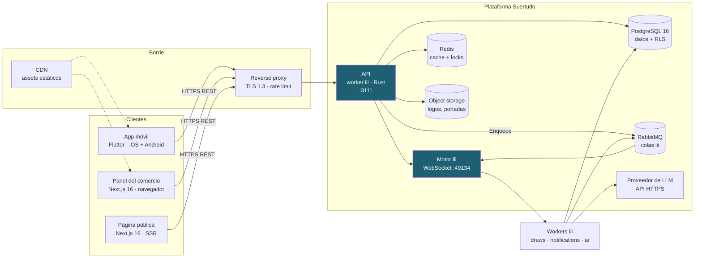

# Arquitectura — Suertudo

> Topología del sistema, decisiones de arquitectura (ADRs) y operación. Complementa a [`api-contract.md`](./api-contract.md) (contratos) y [`data-model.md`](./data-model.md) (esquema).

---

## 1. Vista general



**Punto clave:** el motor iii **nunca** está expuesto a internet. Solo la API HTTP lo consume. Los clientes hablan con la API, que es el único contrato estable del sistema (ver `ADR-002`).

---

## 2. Principios

| # | Principio | Implicación concreta |
|---|---|---|
| 1 | **La API HTTP es el contrato estable** | El motor iii es un detalle de implementación. Ningún cliente lo conhece. |
| 2 | **La lógica de negocio es portable** | Vive en crates Rust con interfaces propias, no en closures de handlers de iii. |
| 3 | **Asíncrono donde corresponde** | Notificaciones, sorteos, exports y generación de IA van por cola. Nunca bloquean un request. |
| 4 | **Idempotencia por diseño** | Las operaciones que pueden repetirse (sorteo, notificación) tienen una barrera en la base, no en la aplicación. |
| 5 | **La base es la fuente de verdad** | Las invariantes críticas (número único, un tema activo, idempotencia) son constraints, no checks de aplicación. |
| 6 | **El aislamiento es responsabilidad de la plataforma** | El `business_id` se deriva del token, se inyecta en el contexto y se aplica en la query y en la RLS. |
| 7 | **Degradar, no caer** | Si la IA falla, hay tema por defecto. Si FCM falla, va el email. Si Redis cae, se va a Postgres. |
| 8 | **Un solo lenguaje en el backend** | Rust en todo el backend. La app móvil y el panel web nunca hablan SQL. |

---

## 3. Capas

| Capa | Responsabilidad | Technology |
|---|---|---|
| **Clientes** | Presentación, estado local, deep links | Flutter 3.47 / Next.js 16 |
| **Borde** | TLS, rate limit, caché estática, WAF | Nginx o Caddy + CDN |
| **API** | Autenticación, autorización, validación, orquestación | Worker iii en Rust, expuesto por el worker `http` |
| **Dominio** | Reglas de negocio, invariantes, transacciones | Crates Rust (independientes de iii) |
| **Persistencia** | Datos relacionales, constraints, RLS | PostgreSQL 16 |
| **Asíncrono** | Colas, reintentos, DLQ | RabbitMQ (vía worker `queue` de iii) |
| **Cache** | Rate limits, locks, resultados públicos | Redis |
| **Almacenamiento** | Logos, portadas, evidencia de entrega | Object storage S3-compatible |
| **IA** | Generación de temas | API de un proveedor de LLM |

---

## 4. Workers iii

### 4.1 Catálogo

| Worker | Crate | Funciones | Triggers |
|---|---|---|---|
| `api` | `suertudo-api` | Endpoints HTTP, middleware de auth, validación | `http` |
| `identity` | `suertudo-identity` | Registro, login, refresh, sesión | `http` |
| `businesses` | `suertudo-businesses` | Onboarding, miembros, planes | `http` |
| `raffles` | `suertudo-raffles` | CRUD de sorteos, publicación, cierre | `http`, `cron`, `state` |
| `participation` | `suertudo-participation` | Reserva de números, validación, cancelaciones | `http` |
| `draws` | `suertudo-draws` | Commit–reveal, ejecución, verificación, liquidación | `http`, `cron` |
| `notifications` | `suertudo-notifications` | Push, email, in-app, expiración de premios | `durable:subscriber`, `cron` |
| `ai-branding` | `suertudo-ai-branding` | Generación y validación de temas | `http` |
| `crm` | `suertudo-crm` | Export CSV, leads | `http`, `durable:subscriber` |
| `audit` | `suertudo-audit` | Escritura en la auditoría | (invocado) |

### 4.2 Estructura de un worker

```
services/raffles/
├── Cargo.toml                 # Crate del worker
├── iii.worker.yaml            # Manifiesto (opcional: ver ADR-011)
├── src/
│   ├── main.rs                # Registro de funciones y triggers
│   ├── handlers.rs            # Adaptadores iii -> dominio
│   ├── domain/                # Lógica pura, sin dependencia de iii
│   │   ├── model.rs
│   │   ├── state_machine.rs
│   │   └── errors.rs
│   ├── ports/                 # Interfaces (trait) de dependencias externas
│   │   ├── repository.rs
│   │   ├── clock.rs
│   │   └── notifier.rs
│   └── adapters/
│       ├── postgres.rs
│       └── redis.rs
└── tests/
    ├── contract.rs            # Tests contra el esquema de iii
    └── domain.rs              # Tests puros de la máquina de estados
```

**La regla que gobierna esta estructura:** `domain/` y `ports/` **no importan nada de `iii_sdk`**. Eso es lo que hace posible cambiar el orquestador (o sacarlo) sin reescribir el negocio. Los `handlers.rs` son adaptadores finos: parsean el payload, llaman al dominio y traducen errores a códigos HTTP.

### 4.3 Comunicación

| Mecanismo | Uso | Por qué |
|---|---|---|
| `worker.trigger()` síncrono | Un worker llama a otro y necesita el resultado | Simple y ordenado |
| `TriggerAction::Enqueue` | Trabajo asíncrono con reintentos y DLQ | Notificaciones, exports, sorteos |
| `iii::durable::publish` | Pub/sub para eventos quetodos miran | Cambios de estado de sorteo que interesta a varios consumidores |
| Canal (streaming) | Datos binarios o flujos grandes | Fase 2: actualización en vivo del feed |
| Postgres | Estado compartido y fuente de verdad | Consistencia transaccional |
| Redis | Cache, rate limit, locks | Latencia |

**Regla de dependencia:** un worker **nunca** llama directo a la base de otro dominio. Llama a la función del otro. Eso mantiene las fronteras y permite mover lógica entre workers sin romper a nadie.

### 4.4 Transacciones y la frontera de la cola

**Regla:** cuando una operación de negocio necesita disparar un efecto asíncrono, escribe en la tabla `outbox` **dentro de la misma transacción** que confirma el cambio. Un proceso aparte publica a la cola.

```rust
// draws::execute_draw — en una sola transacción
let mut tx = pool.begin().await?;

// 1. Barrier de idempotencia: el UNIQUE (raffle_id) de draws
let inserted = sqlx::query_as::<_, Draw>(
    "INSERT INTO draws (...) VALUES (...) ON CONFLICT (raffle_id) DO NOTHING RETURNING ..."
).fetch_optional(&mut *tx).await?;

if inserted.is_none() {
    tx.rollback().await?;
    return Ok(json!({ "skipped": true, "reason": "already_drawn" }));
}

// 2. Revelar la semilla, derivar, crear premios
// 3. Outbox: publicar el evento de notificación
sqlx::query("INSERT INTO outbox (topic, payload) VALUES ($1, $2)")
    .bind("notifications").bind(json!({ ... })).execute(&mut *tx).await?;

tx.commit().await?;
```

Si el proceso se cae entre el commit y la publicación, el publicador del outbox lo recupera. Si se cae antes del commit, no se ejecutó nada. **No hay estado intermedio donde el sorteo se ejecutó pero el ganador no fue notificado.**

---

## 5. ADRs

### ADR-001 — Monorepo con un solo repositorio

**Estado:** Aceptado

**Contexto:** Tres stacks (Rust, Flutter, Next.js) en un producto chico.

**Decisión:** un solo repositorio con directorios por capa, sin workspaces de tooling salvo el de Rust.

```
suertudo/
├── apps/
│   ├── mobile/           # Flutter
│   └── business-web/     # Next.js
├── services/             # Crates Rust (workspace Cargo.toml)
├── packages/             # Tipos compartidos generados (OpenAPI → Dart, TS)
├── infra/
├── docs/
└── .github/workflows/
```

**Consecuencias:** un cambio que atraviesa las tres capas es un solo PR. A cambio, el CI tiene que manejar tres toolchains. Se acepta: el repo se organiza en workflows separados por stack, disparados por path.

**Alternativas descartadas:** repos separados (sincronización manual del contrato de API, dolor innecesario para un equipo chico); monorepo con herramientas tipo Nx/Turborepo (complejidad operativa sin equipo que la justifique).

---

### ADR-002 — iii es el orquestador, no el contrato

**Estado:** Aceptado · **Verificado por el spike `spikes/iii-health`** · Ver [`spike-iii-health.md`](./spike-iii-health.md)

**Contexto:** El SDK de Rust de iii está en **release candidate** (`0.25.0-rc.4`). Un RC puede romper compatibilidad entre versiones.

**Decisión:** el motor iii vive **detrás** de la API HTTP. El dominio no depende de `iii_sdk`. La API es el único contrato que conocen los clientes.

```
Cliente → HTTPS → API HTTP (contrato estable) → [worker iii] → Dominio → Postgres
```

**Consecuencias:**
- Cambiar de orquestador (o sacarlo) es reescribir `handlers.rs`, no el producto.
- Los tests de dominio corren sin motor, sin red y en milisegundos.
- Se pierde una capacidad: invocar funciones de un worker a otro se hace por `trigger`, que sí es API de iii. Se aísla en una capa `ports::orchestrator` con una implementación `iii::Orchestrator` y una `in_process::Orchestrator` para tests.

**Evidencia empírica (spike):** el SDK `0.25.0-rc.4` **compila** contra el engine `0.24.6` y registra funciones sin error, pero su registro de trigger `http` es **rechazado** y queda en `PENDING`: la ruta nunca existe. Es un fallo **silencioso** — `engine::workers::list` muestra el worker como sano. Por eso el smoke test del CI asserta una **ruta respondiendo 200**, no que un worker se haya registrado. Ver [`spike-iii-health.md`](./spike-iii-health.md) §5.2.

**Alternativas descartadas:** usar iii como contrato público (expone el motor a internet y ata el producto a un RC); Axum puro sin iii (descarta la orquestación y las colas que el usuario pidió explícitamente).

**Consecuencia para el middleware.** El middleware de autorización de iii corre en el puerto RBAC del engine, y ahí sí puede mutar el contexto. Pero el worker `http` v0.22.7, que es el que expone las rutas, **no puede transportar un payload mutado al handler**: su middleware solo puede responder o continuar. Por eso los handlers de identidad **resuelven la misma sesión con el mismo código** y encuentran el mismo contexto que el middleware habría inyectado.

El invariante se mantiene igual: **la identidad sale de la sesión, nunca del cuerpo ni del path**. Que el middleware y el handler resuelvan la sesión por separado es una duplicación, no una vía alternativa para leer el tenant del request.

---

### ADR-003 — Rust para todo el backend

**Estado:** Aceptado

**Contexto:** El usuarioexpressed preferencia por Rust y abren a alternativas.

**Decisión:** Rust para workers, dominio e infraestructura.

**Consecuencias:** seguridad de memoria sin GC, excelente para el throughput de sorteos, ecosistema de crates sólido (`sqlx`, `tokio`, `serde`, `schemars`, `ring`/`sha2`).

**Costs reales que asumimos:**
- El tiempo de desarrollo es mayor que con TypeScript.
- Faltan tipos generados para Dart: se genera desde el OpenAPI con `openapi-generator` en CI.
- El ecosistema de auth es más-poor que en otros lenguajes: se usa `jsonwebtoken` + `argon2` a mano, sin framework.

**Alternativas descartadas:** TypeScript (más rápido de escribir, pero pierde elArgumento de concurrencia y el usuario ya quería Rust); Go (buena opción, ecosystem más chico para este dominio); Python (descartado por performance y por el perfil del dominio).

---

### ADR-004 — PostgreSQL como única base de datos

**Estado:** Aceptado

**Contexto:** El dominio es altamente relacional (tickets, números, premios, consentimientos) y tiene invariantes fuertes.

**Decisión:** PostgreSQL 16. Sin Redis para estado (solo cache). Sin base de documentos.

**Consecuencias:** las constraints de Postgres implementan invariantes que en una base de documentos habría que codificar a mano y podrían violarse bajo concurrencia. Row Level Security da una segunda barrera de aislamiento (`ADR-007`).

**Alternativas descartadas:** SQLite (no escala en escritura concurrente ni soporta RLS); MongoDB (las invariantes del dominio son justo lo que un documental store hace peor); DynamoDB (el modelo relacional es natural acá).

---

### ADR-005 — Flutter para la app de participantes

**Estado:** Aceptado

**Contexto:** Requisito del usuario: una app, Android e iOS.

**Decisión:** Flutter 3.47 (Dart 3.13), con:
- **Riverpod** para estado y inyección de dependencias.
- **go_router** para navegación y deep links.
- **dio** para HTTP con interceptores de auth y refresh.
- **freezed + json_serializable** para modelos inmutables.
- **flutter_secure_storage** para tokens.
- **firebase_messaging** para push.
- **cached_network_image** para imágenes de la CDN.
- **flutter_svg** para las variantes de `layout` con ilustraciones vectoriales.

**Estructura: feature-first.**

```
apps/mobile/lib/
├── core/
│   ├── api/            # cliente HTTP, interceptores, manejo de errores
│   ├── auth/           # sesión, refresh, guardas de ruta
│   ├── models/         # DTOs generados desde OpenAPI
│   ├── theme/          # motor de render del theme_spec
│   └── widgets/        # widgets compartidos
├── features/
│   ├── auth/
│   ├── feed/
│   ├── raffle_detail/
│   ├── participate/
│   ├── my_tickets/
│   ├── prizes/
│   └── notifications/
└── main.dart
```

**El motor de render del tema** (`core/theme/`) es una pieza central: traduce el `theme_spec` JSON a `ThemeData` de Flutter. Tiene que implementar **exactamente** las mismas reglas de contraste que el validador del backend. La app es un consumidor pasivo del `theme_spec`: no recalcula colores, no decide, no inventa.

**Consecuencia de mantener Flutter y Next.js en paridad visual:** el `theme_spec` es la **única** fuente de verdad de la Appearance. Los dos renderizadores consumen el mismo JSON. No hay un "color del botón" duplicado en dos código bases.

---

### ADR-006 — Next.js 16 con App Router para el panel

**Estado:** Aceptado

**Contexto:** El panel del comercio es una aplicación web con mucho formulario y tablas.

**Decisión:** Next.js 16 (App Router) + React 19 + TypeScript estricto.

| Pieza | Elección | Razón |
|---|---|---|
| Data fetching | **Route Handlers** + React Server Components | El panel lee de la API Rust, no de la base. Los Server Components exigen el token del usuario, que vive en una cookie httpOnly. |
| Estado de servidor | **TanStack Query** | Cache, invalidación y revalidación. |
| Formularios | **React Hook Form** + **Zod** | Validación compartida con la API (el mismo schema Zod). |
| Estilos | **Tailwind CSS 4** | Los tokens del `theme_spec` se inyectan como variables CSS. |
| Componentes | **shadcn/ui** | Radix + Tailwind, sin dependencia de runtime. |
| Tablas | **TanStack Table** | Sorteo, paginación y virtualization para la lista de participantes. |
| Gráficos | **Recharts** | Métricas del panel. |
| i18n | **next-intl** | Listo para multi-idioma (Fase 3) sin refactor. |

**El panel es una SPA autenticada con SSR mínimo.** Las rutas bajo `/panel/*` son privadas: middleware de Next.js valida la sesión antes de renderizar y redirige a `/login`.

**La página pública del sorteo** (`/s/[slug]`, Fase 2) sí es SSR/SSG con Open Graph completo, porque el objetivo es que se comparta en Instagram y WhatsApp y se vea bien en el previsualizador.

---

### ADR-007 — Row Level Security como segunda barrera

**Estado:** Aceptado

**Contexto:** El aislamiento entre negocios es el riesgo de mayor impacto del producto (`R6`).

**Decisión:** además de la autorización en la aplicación, se activan políticas RLS en Postgres.

```sql
CREATE POLICY tickets_isolation ON tickets
USING (
    business_id = current_setting('app.business_id', true)::uuid
    OR user_id    = current_setting('app.user_id', true)::uuid
);
```

La API setea `SET LOCAL app.business_id` y `SET LOCAL app.user_id` en **toda** transacción.

**Fail closed:** si las variables no están seteadas, `current_setting(..., true)` devuelve `NULL`, la comparación es `NULL` y la política no matchea. **Una sesión sin contexto no lee nada.**

**Consecuencia:** un `WHERE` olvidado en el código no expone datos entre negocios. El error se manifiesta como "no trae nada", no como "trae datos de otro tenant". Eso es exactamente lo que se quiere.

**Cost:** un `SET LOCAL` por transacción y un plan de queries ligeramente más complejo. Se acepta: el costo de una fuga de datos entre negocios es el costo del producto.

**El rol de la aplicación no puede ser el propietario del esquema.** Postgres no le aplica las políticas de RLS a quien posee la tabla. Si la API conecta con el rol que creó el esquema, **la segunda barrera no existe**. El rol de aplicación se crea en el despliegue, nunca en una migración: una contraseña no pertenece a un archivo de esquema. Los tests de RLS conectan con un rol aparte, por el mismo motivo.

**Dos excepciones públicas, y son deliberadas.** `raffles` se puede leer cuando `status = 'published'` y `draws` cuando `seed_revealed = true`. Sin ellas, el feed público y la **verificación pública del sorteo** —la promesa de confianza del producto— devolverían cero filas. Todo lo demás falla cerrado.

**El RLS real cubre 13 tablas de tenant**, más `audit_log` y `outbox`. `users`, `auth_tokens` y `token_families` también están cubiertas, pero su aislamiento no se expresa con políticas: el login no tiene contexto de tenant, así que usa funciones `SECURITY DEFINER` de cuerpo fijo. El detalle está en [`data-model.md`](./data-model.md) §3.20 y §3.24.

---

### ADR-008 — Sorteo propio con commit–reveal

**Estado:** Aceptado

**Contexto:** El `idea.md` propone "realiza el sorteo o consulta la lotería de dónde salen los números elegidos".

**Hecho verificado:** las loterías argentinas (Lotería Nacional, Lotería de la Ciudad) **no publican una API pública oficial**. Toda integración sería scraping, frágil y con Terms of Service dudosos. Además, ataría el calendario del sorteo a la lotería.

**Decisión:** el origen del número es propio, con commit–reveal. Se implementan `draw_source = 'own_draw'` y la interfaz de adaptador queda preparada para `external_lottery`, que se evalúa en Fase 3.

**Consecuencias:**
- El calendario, la cobertura y el número de premios los define el negocio.
- El resultado es auditable por un tercero sin depender de la plataforma.
- Se pierde la familiaridad de "el número de la LNA". Se compensa con la transparencia: la LNA no publica el método de derivación.

**Alternativas descartadas:** integrar LNA por scraping (fragilidad + ToS + dependencia de un tercero sin SLA); usar un RNG con seed secreta sin compromiso (no es verificable, y un employee con acceso al servidor podría elegir la semilla después de ver las reservas).

---

### ADR-009 — IA externa con validación determinista

**Estado:** Aceptado

**Contexto:** La generación de temas necesita un LLM. El LLM es no determinístico y puede devolver basura.

**Decisión:** LLM externo (API HTTPS) para proponer, **validación determinista en Rust** para decidir.

```
LLM (probabilístico) → JSON Schema → anclas → contraste → copy → versionado
```

**Consecuencias:**
- El contraste y las anclas de marca son **garantías**, no estadísticas (`NFR-AI-03` = 100 %, `NFR-AI-04` = 0 % de violaciones).
- El tema por defecto es un fallback real, no un placeholder.
- Se puede correr el mismo validador en CI sin llamar al modelo (evals).
- Se puede cambiar de proveedor de LLM sin tocar el producto.

**Alternativas descartadas:** generar el CSS/HTML directamente con el modelo (imposible de validar, de revisar y deAccessibility); prompt con few-shot y sin validación (el modelo "casi siempre" acierta, y "casi siempre" en un color de texto ilegible es un bug que llega al usuario).

---

### ADR-010 — Sin pasarela de pagos en el MVP

**Estado:** Aceptado

**Contexto:** El participante podría pagar por sus números. Se decidió que no.

**Decisión:** sin pagos del participante. La monetización es la suscripción del comercio, gestionada manualmente en el MVP.

**Consecuencias:** sin PCI-DSS, sin KYC de participantes, sin ledger, sin split settlement, y sin la discusión regulatoria del juego de azar con contraprestación.

**Se agrega en Fase 2** una integración de cobro **de la suscripción del comercio** (Mercado Pago o Stripe), que es un problema de B2B SaaS, no de pagos al usuario. Es un proyecto separado con su propio ADR.

---

### ADR-011 — Los workers corren como procesos propios, no en microVM de iii

**Estado:** Aceptado · **Verificado por el spike `spikes/iii-health`**

**Contexto:** El aislamiento por microVM de iii requiere `/dev/kvm`. En CI y en muchos servicios de cloud eso no está disponible.

**Hecho verificado (documentación de iii):** *"Any process that uses an iii SDK, calls `registerWorker()`, and connects to a iii instance is a worker, and behaves identically whether iii started it or not."* El manifiesto `iii.worker.yaml` solo importa si iii provisions el worker.

**Verificado empíricamente (spike):** el worker `http` del registro es `Type: binary` y corre como proceso del host. El spike levanta el stack completo dentro de un namespace de mounts con `/dev/kvm` enmascarado y comprueba que ningún proceso `iii-worker` llega a existir. Ver [`spike-iii-health.md`](./spike-iii-health.md) §5.1.

**Decisión:**
- **Desarrollo y CI:** los workers corren como procesos locales (`cargo run`), conectando al motor por WebSocket. Sin microVM, sin KVM.
- **Producción:** los workers corren en contenedores Docker gestionados por el orquestador de iii **o** por Docker Compose, según el tamaño del despliegue. La opción de microVM queda para cuando el aislamiento por tenant lo justifique.

**Consecuencias:** el `iii.worker.yaml` se mantiene en el repo (documenta el runtime y las dependencias) pero **no es obligatorio** para que un worker funcione. El CI no necesita KVM.

**Trampa operativa (medida en el spike):** los workers del registro (`http`, `queue`, `cron`) **se reconectan solos al engine** después de una caída. Si sobreviven a una corrida, la siguiente falla con `CONTAINER_NAME_TAKEN`. Su nombre de proceso es el del paquete (`http`, `queue`, `cron`), y **`cron` colisiona con el scheduler del sistema** (`/usr/sbin/cron`): un `pkill -x cron` mata el cron de la máquina. El teardown tiene que identificarlos por su **ruta de ejecutable** bajo `~/.iii/compose/packages/`, nunca por nombre. Ver [`spike-iii-health.md`](./spike-iii-health.md) §5.8.

**Los tipos de trigger no vienen con el engine.** `http`, `durable:subscriber` y `cron` son workers del registro separados (`http` 0.22.7, `queue` 0.21.22, `cron` 0.21.26). Sin ellos, el trigger queda `PENDING` para siempre y el engine lo avisa en el log. `worker-compose.yaml` tiene que declarar los tres. Ver [`spike-iii-health.md`](./spike-iii-health.md) §5.6.

---

### ADR-012 — El motor iii no se expone a internet

**Estado:** Aceptado

**Contexto:** Los workers se registran en el motor por WebSocket. El motor es el que enruta invocaciones.

**Decisión:** el motor iii escucha solo en la red interna. La API HTTP es el único componente con exposure pública. El `worker-manager` de iii (listeners RBAC) se usa para las conexiones de workers, con autenticación.

**Consecuencias:** ningún cliente puede invocar una función interna arbitrariamente. El vector de ataque público es la API, que tiene su propia capa de auth, validación y rate limit.

### ADR-013 — El transporte de la cola es `builtin`, no RabbitMQ

**Estado:** Aceptado · **Medido en el spike `spikes/iii-health`**

**Contexto:** el worker `queue` de iii ofrece tres transportes: `builtin` (in-process, file-backed, default), `redis` (pub/sub, sin DLQ ni reintentos) y `rabbitmq` (completo, con broker externo). La decisión importa porque de ella depende si el equipo puede **operar** los mensajes que fallaron.

**Medición.** Los dos transportes se verificaron con el mismo script (`QUEUE_ADAPTER=builtin|rabbitmq unshare -rm ./scripts/smoke.sh`):

| Operación | `builtin` | `rabbitmq` |
|---|---|---|
| Publicar y consumir | ✅ | ✅ |
| Named queue con `TriggerAction::Enqueue` | ✅ | ✅ |
| 3 reintentos con backoff y envío a DLQ | ✅ | ✅ |
| `engine::queue::dlq_messages` (listar la DLQ) | ✅ ve el mensaje | ❌ devuelve `[]` |
| `engine::queue::dlq_topics` | ✅ | ❌ devuelve `[]` |
| `engine::queue::topic_stats` → `dlq_depth` | ✅ correcto | ❌ reporta `0` **mintiendo** |
| `iii::queue::redrive` (reprocesar) | ✅ | ❌ `NOT_FOUND: no queue 'iii.spike-fail.dlq'` |
| `iii::queue::discard_message` | ✅ | ❌ (misma causa que el redrive) |

**Causa raíz:** en RabbitMQ los reintentos escriben en la DLQ **por función** (`iii.{topic}.{function_id}@{ns}.dlq`), pero la API de DLQ de iii direcciona el **topic desnudo** (`iii.{topic}.dlq`). El mensaje queda en el broker y es **inalcanzable desde iii**: nadie puede verlo, reprocesarlo ni descartarlo sin usar la API de administración de RabbitMQ a mano.

**Decisión:** el transporte de producción es **`builtin`**.

**Consecuencias:**
- La DLQ es operable con la API de iii: listar, reprocesar y descartar funcionan.
- **No hace falta un broker externo.** Un servicio menos que operar, un menos que puede caerse. La cola persiste en disco (`file_based`) y sobrevive a reinicios.
- El worker `queue` es de un solo proceso. Suficiente para el volumen de Suertudo: notificaciones, exports y ejecuciones de sorteo.
- Si en el futuro hace falta escalar el worker de cola horizontalmente, el cambio de adaptador es un cambio de configuración en caliente: *"Changing the adapter config hot-swaps the transport and restarts every consumer"*. La ruta de código no cambia.

**Condición de reevaluación:** cuando el volumen justifique varios workers de cola consumiendo en paralelo, **y** se acepte que la DLQ se opere contra la API de RabbitMQ en lugar de la de iii.

**Nota de la doc de iii:** la propia documentación reconoce el problema y lo remite a un ticket upstream (`MOT-3904`): *"On the rabbitmq transport this makes DLQ browse/redrive against a subscriber topic 404 ... Upstream engine fix tracked as MOT-3904"*. Cuando ese fix llegue, la comparación hay que repetirla.

---

## 6. Frontend móvil

### 6.1 Capas

```
Widget (presentación)
   ↓
Provider Riverpod (estado + dependencias)
   ↓
UseCase / Controller (orquestación de la pantalla)
   ↓
Repository (interface)
   ↓
ApiClient (dio)  |  LocalStore (drift/hive)
```

**Regla:** los widgets no conocen la API. Los repositorios no conocen HTTP (conozcan la interfaz). La lógica de negocio que no depende de Flutter (validación de un tema, cálculo de cobertura) vive en un paquete Dart puro, testeable sin widgets.

### 6.2 Estado

| Tipo de estado | Dónde vive | Ejemplo |
|---|---|---|
| Remoto (cacheable) | TanStack-like en Riverpod (`AsyncNotifier` + `FutureProvider`) | Feed de sorteos, detalle |
| Remoto (no cacheable) | `StateNotifier` efímero | Estado de una reserva en curso |
| Local persistente | `drift` (SQLite) | Tickets cacheados para uso offline |
| Sesión | `flutter_secure_storage` + `AuthNotifier` | Access y refresh token |
| Preferencia | `shared_preferences` | Onboarding visto, tema del sistema |

### 6.3 Offline

**Decisión explícita:** la app es *offline-tolerant*, no *offline-first*.

| Funcionalidad | Offline |
|---|---|
| Ver el feed | Sí, desde cache (con timestamp de "actualizado hace X") |
| Ver el detalle de un sorteo | Sí, desde cache |
| Ver mis participaciones | Sí, desde cache |
| **Reservar números** | **No.** Requiere conexión. |
| **Reclamar un premio** | **No.** Requiere conexión. |

**Por qué:** reservar números offline abre la puerta a la reserva duplicada y a la inconsistencia de números. La app lo impide explícitamente y muestra un mensaje claro.

### 6.4 Push

`firebase_messaging` + un worker Rust que llama a **FCM HTTP v1**. Se elige FCM HTTP v1 y no el SDK legacy porque es el único camino soportado a mediano plazo.

**El registro del token es idempotente:** `POST /v1/me/devices` con `UPSERT` sobre el `token` único. Un token que responde `Unregistered` se marca `inactive` y no se reintenta.

---

## 7. Frontend web

### 7.1 Rutas

```
/                          → landing (Fase 2)
/login, /register           → auth
/panel                     → dashboard del comercio
/panel/raffles             → listado
/panel/raffles/[id]        → detalle + edición + tema
/panel/raffles/[id]/participants  → participantes + export
/panel/raffles/[id]/prizes        → premios
/panel/leads               → fidelización
/panel/settings            → negocio, marca, plan, miembros
/s/[business]/[slug]       → página pública del sorteo (Fase 2)
/verificar/[public_id]     → verificación pública (Fase 2)
```

### 7.2 Autenticación

- Cookie `httpOnly` + `secure` + `SameSite=Lax` para el refresh token.
- El access token vive **solo en memoria** (contexto de React), nunca en `localStorage`.
- Un Route Handler (`/api/session`) refresca el token cuando el acceso a un Server Component devuelve 401.
- El middleware de Next.js (`middleware.ts`) valida la presencia de la sesión y redirige.

### 7.3 Tema en el panel

El `theme_spec` del sorteo se renderiza con un **preview** que usa los mismos tokens que la app móvil, vía variables CSS generadas desde el JSON:

```css
:root {
  --st-primary: #1E5F74;
  --st-primary-soft: #E8F1F3;
  --st-radius: 16px;
  --st-display-family: serif;
  --st-display-size: 34px;
}
```

El generador de variables es una función pura y testeada: `themeSpecToCssVars(spec) -> Record<string, string>`. El preview del panel es un iframe o un componente que aplica esas variables, de modo que el comercio ve **el mismo resultado** que va a ver el participante.

---

## 8. Infraestructura

### 8.1 Componentes

| Componente | Imagen / versión | Rol |
|---|---|---|
| iii engine | Binario (`install.iii.dev`) | Orquestación |
| iii compose | incluido | Gestión de workers |
| API | `rust:1.9x-slim` multi-stage | Binario estático (musl) |
| PostgreSQL | `postgres:16-alpine` | Datos |
| RabbitMQ | `rabbitmq:3.13-alpine` | Colas de iii |
| Redis | `redis:7-alpine` | Cache, rate limit, locks |
| MinIO | `minio/minio` (dev) | Object storage local; S3 en prod |
| Nginx | `nginx:alpine` | TLS, reverse proxy, rate limit |
| Mailpit | `axllent/mailpit` (dev) | Buzón de emails de prueba |

### 8.2 `docker-compose.yml` (desarrollo)

```yaml
services:
  iii:
    image: iiidev/iii:latest
    ports: ["49134:49134", "3111:3111", "3113:3113"]
    volumes: ["./infra/iii:/etc/iii"]
  postgres:
    image: postgres:16-alpine
    environment:
      POSTGRES_DB: suertudo
      POSTGRES_USER: suertudo
      POSTGRES_PASSWORD: suertudo
    ports: ["5432:5432"]
    volumes: ["pgdata:/var/lib/postgresql/data"]
  rabbitmq:
    image: rabbitmq:3.13-alpine
    ports: ["5672:5672", "15672:15672"]
  redis:
    image: redis:7-alpine
    ports: ["6379:6379"]
  minio:
    image: minio/minio
    command: server /data --console-address ":9001"
    ports: ["9000:9000", "9001:9001"]
  mailpit:
    image: axllent/mailpit
    ports: ["1025:1025", "8025:8025"]
```

### 8.3 Secretos

| Secreto | Dónde vive |
|---|---|
| `DATABASE_URL` | Secret manager (env en local) |
| `JWT_SECRET` / `JWT_REFRESH_SECRET` | Secret manager |
| `REDIS_URL` | Secret manager (env en local). **Obligatoria** para los workers que limitan tasas (`identity` hoy): sin el store de contadores el worker **no arranca**. |
| `SEED_ENCRYPTION_KEY` | Secret manager, **rotable** (ver §8.4) |
| `FCM_SERVICE_ACCOUNT` | Secret manager |
| `EMAIL_API_KEY` | Secret manager |
| `LLM_API_KEY` | Secret manager |
| `RABBITMQ_URL` | Secret manager |

**Ninguno en el repo.** En desarrollo, un `.env.example` documenta las variables y un `.env` local (gitignored) las define. CI usa secrets del repositorio.

### 8.4 Rotación de la clave de semilla

La clave AES-256-GCM que cifra las semillas **no se puede rotar sin re-cifrar**. Por eso se usa un esquema de sobre:

```
seed_ciphertext = nonce(12B) || ciphertext || tag(16B)
key_id          = uuid de la clave usada
```

El `key_id` se guarda junto al ciphertext. Rotar es: descifrar con la clave vieja, re-cifrar con la nueva, actualizar `key_id`. Se implementa como un job de mantenimiento que corre después de la rotación.

**La clave nunca se descarta mientras haya sorteos sin revelar.** Un sorteo publicado y no sorteado con su semilla cifrada bajo una clave destruida es un sorteo que no se puede sortear.

### 8.5 Entornos

| Entorno | Datos | IA | Push | Email |
|---|---|---|---|---|
| `local` | Postgres local + Mailpit | Modelo chico, presupuesto de 5 llamadas/día | FCM sandbox | Mailpit |
| `staging` | Postgres y RabbitMQ dedicados | Modelo real, presupuesto limitado | FCM sandbox | Proveedor real, solo a emails `@suertudo.app` |
| `production` | Cluster gestionado | Modelo real | FCM producción | Proveedor real |

**Regla:** en `local` y `staging` no se mandan push ni emails reales salvo que el destinatario esté en una allow-list. Un test que dispara notificaciones en staging no debe llegar a un usuario real.

### 8.6 Versiones de iii

**Versión fijada: engine `0.24.6` + `iii-sdk` `0.24.6`.** El archivo `infra/iii/VERSION` los declara juntos y el CI verifica que coincidan.

```yaml
# infra/iii/VERSION
iii=0.24.6
iii-sdk=0.24.6
```

**Por qué 0.24.6 y no el 0.25 RC.** Medido en el spike (`spikes/iii-health`):

| SDK crate | Compila | Registra función | Registra trigger `http` |
|---|---|---|---|
| `0.24.6` | sí | funciona | **funciona** — la ruta responde |
| `0.25.0-rc.4` | sí | funciona | **rechazado** — queda en `PENDING`, la ruta nunca existe |

El RC deprecó `register_trigger` en favor de `iii.observe(...)`, que el engine 0.24.6 no implementa. El resultado es un estado **medio roto y silencioso**: la función aparece registrada en `engine::workers::list` (todo parece bien) pero la ruta HTTP no existe. Eso es peor que un error de compilación, y es la razón concreta de que la regla de §8.7 exija assertar una **ruta respondiendo 200**, no solo un worker registrado.

> **Nota:** el texto de esta tabla se corrigió durante la redacción; la API del RC es `iii.observe`, no `iii.observe`-con-varios-argumentos. Verificar la firma exacta contra `docs.rs` de la versión instalada antes de migrar.

### 8.7 Actualización de iii

El SDK y el motor de iii evolucionan rápido y el crate de Rust está en **release candidate**. Esta sección define el procedimiento para subirlos sin romper producción.

**Procedimiento**

1. Leer el changelog y las notas de upgrade de la versión destino. Cada salto de minor tiene una guía de upgrade propia.
2. Actualizar el crate en `Cargo.toml` **en un PR propio**, sin cambios de código. Esto aísla el impacto.
3. `cargo build` + `cargo test`. Los cambios de API del SDK aparecen como errores de compilación explícitos.
4. Levantar el motor de la versión nueva en un entorno de prueba y correr el smoke test (§9.2) contra él.
5. Redeclarar las colas durables de RabbitMQ si la versión los renombra (ver abajo).
6. Verificar en la consola de iii que todas las funciones están registradas y que no hay conflictos de namespace.
7. Desplegar el motor nuevo primero, con los workers viejos corriendo. Verificar que los workers se reconectan y re-registran sus funciones.
8. Desplegar los workers nuevos.

**Renombrado de colas de RabbitMQ (0.22.x → 0.23.x)**

Los nombres de las colas durables en RabbitMQ **cambiaron en iii 0.23.x y no se migran automáticamente**. Si no se redeclaran, los mensajes encolados en la cola vieja quedan huérfanos y las notificaciones dejan de enviarse.

**Chequeo obligatorio en cada upgrade:**

```bash
# 1. Listar los topics y las colas con nombre que existen ahora
iii trigger engine::queue::list_topics
iii trigger engine::queue::topic_stats topic=notifications

# 2. Verificar la profundidad de la DLQ ANTES de migrar
iii trigger engine::queue::dlq_topics
iii trigger engine::queue::dlq_messages topic=notifications

# 3. Tras el upgrade, confirmar que la cola vuelve a recibir mensajes
iii trigger engine::queue::topic_stats topic=notifications
```

**Antes de cualquier upgrade**, la DLQ debe estar vacía. Si hay mensajes dead-letterados, se redrivean o se descartan **explícitamente** y se registra la decisión: un mensaje perdido en una migración es un ganador que nunca fue notificado.

**Rollback.** El motor de iii se puede volver a la versión anterior reiniciando el binario, pero **los workers no pueden**: el crate del SDK puede haber cambiado de forma incompatible. Por eso el paso 1 (PR de actualización de crate, sin cambios de código) es un PR independiente y reversible por sí mismo.

**Regla de versionado:** la versión del motor y la del crate se fijan juntas en un archivo (`infra/iii/VERSION`), y el CI verifica que coincidan. No se usa `latest` en ningún entorno fuera de `local`.

```yaml
# infra/iii/VERSION
iii=0.25.0-rc.4
iii-sdk=0.25.0-rc.4
```

---

## 9. CI/CD

> **El manual operativo está en [`ci-pipeline.md`](./ci-pipeline.md):** cómo correr cada job en local, qué falla y por qué, las recetas (cambiar una versión, regenerar el cache de sqlx, agregar un check) y las trampas. Esta sección dice **por qué** el pipeline es como es; el manual dice **cómo se usa**.

### 9.1 Pipelines

El pipeline está partido en dos archivos, y la partición es de naturaleza, no de tamaño:

| Archivo | Jobs | Qué corre |
|---|---|---|
| `.github/workflows/ci.yml` | `rust`, `flutter`, `nextjs` | El código, en minutos, en cada push |
| `.github/workflows/smoke.yml` | `smoke` | El stack de iii entero, de punta a punta, sin KVM |

**Por qué el smoke test está aparte.** Es el único job que necesita el motor, la red y minutos, y es el único que vale la pena correr **por calendario**: si una versión upstream del motor rompe el stack, tiene que aparecer en el pipeline del lunes y no en el próximo PR que toca el backend. También se puede correr a mano, con `workflow_dispatch`.

**El orden dentro de `ci.yml` no es arbitrario.** Lo más barato y lo más informativo va primero, para que un error se encuentre en segundos y no en minutos:

| Job | Comprueba | Con qué |
|---|---|---|
| `rust` | `fmt --check`, `clippy -D warnings`, `test --workspace`, `cargo audit` | Un Postgres 16 de servicio |
| `flutter` | `analyze`, `format --set-exit-if-changed`, `test` | Flutter 3.47.7 |
| `nextjs` | `lint`, `tsc --noEmit`, `build` | Node 26.12.0 |

**Una sola fuente de verdad para cada versión.** Un CI que compila con otro compilador que el del desarrollador es un CI que prueba otra cosa:

| Qué | Dónde vive la versión | Quién la lee |
|---|---|---|
| Rust | `rust-toolchain.toml` | `rustup`, en local y en el CI |
| Node | `apps/business-web/.nvmrc` | `setup-node` con `node-version-file` |
| Flutter | el número exacto, en `ci.yml` | `flutter-action` |
| iii | `infra/iii/VERSION` | el paso que instala el motor |

El motor y el SDK se fijan juntos en `infra/iii/VERSION` y se mueven en el mismo pull request (`§8.6`). El CI instala **la versión declarada**, no la última: una versión nueva del motor puede romper el stack en silencio, y eso tiene que ser un cambio explícito y revisado.

**El check del cache offline de sqlx.** El cache de `services/db/.sqlx` está commiteado a propósito: sin él, `cargo build` en un checkout limpio falla con errores de compilación de los macros `query!`. El CI comprueba que ese cache siga coincidiendo con el esquema, y lo hace **sin** `cargo sqlx prepare --check`, que obligaría a instalar `sqlx-cli`:

1. Los tests corren primero: el harness aplica las migraciones, así que el esquema existe.
2. El build se hace con la base de datos viva y con `SQLX_OFFLINE_DIR` apuntando al cache commiteado. Los macros se expanden contra el esquema real y **escriben** el cache.
3. Si una query cambió sin regenerar el cache, aparece un archivo nuevo en `services/db/.sqlx`, y `git status --porcelain` lo ve.

`SQLX_OFFLINE` **no** se pone en ese paso, a propósito: con él, los macros leerían el cache en vez del esquema, y el check pasaría sin comparar nada.

**Lo que todavía no está, y por qué:**

- **El job de contrato** compararía el OpenAPI generado contra el commiteado. Hoy no hay OpenAPI: el contrato vive escrito a mano en [`api-contract.md`](./api-contract.md) y la API sólo expone `/v1/health`. No hay nada que diferenciar todavía, y un job que compara un archivo contra sí mismo no es un check.
- **El job de evals de IA** correría sólo si el PR toca `services/ai-branding/`. Ese crate no existe: la IA de tema es parte de la Fase 2.

### 9.2 El problema de KVM en CI

Los workers de iii **no** requieren microVM si corren como procesos (`ADR-011`). El motor levanta sin KVM porque no provisions workers: los tests levantan sus workers como procesos normales.

El smoke test fuerza ese camino a propósito, con `unshare -rm`:

```bash
unshare -rm ./scripts/smoke.sh
```

El script es autocontenido: **compila el worker de prueba antes de arrancarlo**. El spike está excluido del workspace de Rust (tiene su propio lockfile y su propio pin del SDK), así que `cargo build --workspace` no lo construye, y un script que necesita un binario compilado a mano es un script que sólo funciona en la máquina de quien lo escribió.

El script verifica el stack entero, y **su propio encabezado enumera lo que verifica**, uno por uno. Esa lista vive en el script y no acá: dos listas de lo mismo se desincronizan sin que nadie lo note, y la del script es la que se puede leer junto al código que la cumple.

Lo que cubre, en resumen:

- **El stack levanta sin KVM.** El motor, los workers del registro (`http`, `queue`, `cron`) y un worker Rust propio. Y se comprueba que no se usó ninguna microVM.
- **No queda nada de una corrida anterior.** Al principio del script se comprueba que no hay procesos iii vivos: es la precondición de la corrida siguiente.
- **Las rutas responden de verdad.** Un `200` por HTTP y una invocación directa por el engine —un worker registrado puede no tener ninguna ruta, y ese fue exactamente el fallo del RC.
- **La cola funciona de punta a punta.** Publicar y consumir, encolar por función, un consumidor que falla reintenta (el número de reintentos lo fija [`scripts/smoke.sh`](../scripts/smoke.sh), en su sección de reintentos y DLQ) y después llega a la DLQ, y la DLQ se puede listar, reprocesar y descartar.
- **El cron dispara.** Y la derivación conserva su valor dorado.

**Verificación en CI:** este job es el que habría atrapado los dos errores que más costaron: un tipo de trigger que no queda registrado, y una versión del SDK que rompe las rutas en silencio. Los dos son silenciosos — el worker parece sano en `engine::workers::list` y la función simplemente nunca corre.

### 9.3 Despliegue

| Etapa | Trigger | Acción |
|---|---|---|
| `main` | merge a `main` | Build de imágenes, migraciones (con lock), deploy a staging, smoke tests |
| `tag` | tag `v*` | Deploy a producción, migraciones, smoke tests, canary |

**Migraciones:** se ejecutan **antes** del deploy de los workers, con un lock de migración (advisory lock de Postgres). El deploy es rolling: los workers nuevos se registran en el motor, y los viejos se drenan.

**Compatibilidad hacia atrás:** durante el deploy, la versión nueva del esquema debe ser compatible con la versión vieja del código. Se sigue el patrón *expand/contract*: primero se agrega (nullable, columna nueva), después se migra la app, y recién al final se elimina lo viejo.

---

## 10. Observabilidad

| Capa | Herramienta | Qué se ve |
|---|---|---|
| Trazas | OpenTelemetry (vía `iii-helpers::observability`) | Flujo completo: request → worker → cola → worker |
| Logs | `tracing` + sink a Loki/CloudWatch | Logs estructurados con `request_id`, `trace_id` |
| Métricas | Prometheus + Grafana | Latencia, errores, profundidad de colas, DLQ, IA |
| Errores | Sentry (Rust + Dart + TS) | Excepciones con contexto y release |
| Operación | Consola de iii | Workers, funciones, triggers, logs, traces, state |

**Correlación:** el `trace_id` de W3C se propaga desde el cliente (header `traceparent`) a través de la API, los workers y la cola. Un usuario que reporta "no me llegó la notificación" se puede seguir de punta a punta.

**Alertas críticas:**

| Alerta | Condición | Severidad |
|---|---|---|
| Sorteo no ejecutado | `draws_at + 5min < now()` y `status = 'closed'` | Crítica |
| Sorteo sin commitment | Sorteo `published` sin fila en `draws` | Crítica |
| DLQ no vacía | Cualquier mensaje en dead letter | Alta |
| Cola creciendo | Profundidad > 1000 por 5 min | Media |
| Errores de API | Tasa de 5xx > 2 % por 5 min | Alta |
| IA degradada | `ai_fallback_total` > 20 % en 1 h | Media |
| Push caído | `notifications::dispatch` con 90 % de fallo en 15 min | Alta |

---

## 11. Estrategia de testing

| Nivel | Qué cubre | Dónde vive | Velocidad |
|---|---|---|---|
| **Unitario — dominio** | Máquinas de estado, derivación del sorteo, contraste WCAG, validación de schema | `services/*/src/domain` | < 1 s |
| **Unitario — adaptadores** | Repos con `sqlx` contra un Postgres de test | `services/*/tests` | < 5 s |
| **Integración — iii** | Registro de funciones, invocación, triggers, colas | `services/*/tests/contract.rs` | < 30 s |
| **Contrato — API** | OpenAPI generado vs. implementación real | `services/contract-tests` | < 60 s |
| **Aislamiento** | Token de A contra datos de B | `services/contract-tests` | < 60 s |
| **E2E — API** | Flujo completo: crear → publicar → reservar → sortear → notificar | `services/e2e` | < 2 min |
| **Widget — Flutter** | Widgets y providers | `apps/mobile/test` | < 30 s |
| **Componente — Next.js** | Componentes y hooks | `apps/business-web` | < 30 s |
| **E2E — app** | Recorrido crítico en emulador (2 dispositivos) | `apps/mobile/integration_test` | < 10 min |
| **Evals de IA** | Set dorado de 30 casos | `services/ai-branding/evals` | < 5 min, manual |

**Reglas de cobertura obligatoria:**

1. La **derivación del sorteo** tiene un test que reproduce el ejemplo del PRD con valores fijos. Si alguien cambia la fórmula, ese test falla.
2. La **reserva de números** tiene un test de concurrencia: N clientes pidiendo el mismo número a la vez → exactamente 1 gana.
3. El **aislamiento entre negocios** tiene un test que intenta leer datos ajenos por cada endpoint de negocio.
4. El **validador de contraste** tiene tests con pares conocidos (blanco sobre negro = 21:1, gris medio = fallar).
5. La **idempotencia del sorteo** tiene un test que lanza 5 ejecuciones concurrentes y verifica 1 fila en `draws`.

**Regla de oro:** un test que depende de la red, del reloj real o de un proveedor externo **no** es un test unitario. El reloj se inyecta (`ports::Clock`), el proveedor de IA se mockea, la DB es una de test.

---

## 12. Rendimiento

| Cuello de botella | Mitigación |
|---|---|
| Listado del feed con conteo de números | `raffles.numbers_reserved` desnormalizado |
| Números disponibles de un sorteo | `GET /public/raffles/{id}/numbers/{n}` con cache de 30 s en Redis |
| Feed público cacheado | Redis, TTL 60 s, invalidado por el trigger `state` al cambiar un sorteo |
| Export de 50 000 participantes | Job asíncrono: se encola, se genera el CSV, se devuelve un link firmado de 15 min |
| Lista de participantes del panel | Paginación por cursor + virtualization en la tabla |
| Verificación pública | Cacheable agresivamente (el resultado es inmutable) |
| Reservas concurrentes del mismo sorteo | `SELECT ... FOR UPDATE` sobre la fila del sorteo |

---

## 13. Seguridad

| Capa | Medida |
|---|---|
| Borde | TLS 1.3, HSTS, rate limit por IP, `security headers` (CSP, `X-Frame-Options`) |
| API | JWT de acceso (15 min) + refresh rotativo (30 días), RBAC, validación de entrada, idempotencia |
| Datos | TLS a Postgres, cifrado en reposo de campos sensibles, RLS, `business_id` derivado del token |
| Credenciales | Argon2id para contraseñas, secretos en secret manager, rotación documentada |
| PII | Logs y traces sin PII cruda; `ip_hash` con salt rotativo; datos de contacto cifrados |
| Supply chain | `cargo audit` y `npm audit` en CI; bloqueo de merges con vulnerabilidades altas |
| Dependencias de terceros | Versiones pineadas con lockfile; actualizaciones Dependabot agrupadas por PR |
| Sorteos | Semilla CSPRNG, compromiso publicado antes de abrir, revelado permanente, verificación pública |
| Upload de archivos | Validación de tipo MIME real (magic bytes), límite de tamaño, nombres generados, serving desde una dominio separado con CSP estricta |

**El storage de assets se sirve desde un dominio distinto del de la API** (`cdn.suertudo.app`), con CSP estricta, para que un SVG subido no pueda ejecutar script en el contexto de la app.

---

## 14. Resumen de decisiones

| # | Decisión | Estado |
|---|---|---|
| ADR-001 | Monorepo único | Aceptado |
| ADR-002 | iii es orquestador, no contrato | Aceptado |
| ADR-003 | Rust para todo el backend | Aceptado |
| ADR-004 | PostgreSQL único | Aceptado |
| ADR-005 | Flutter con Riverpod y feature-first | Aceptado |
| ADR-006 | Next.js 16 App Router | Aceptado |
| ADR-007 | RLS como segunda barrera | Aceptado |
| ADR-008 | Sorteo propio commit–reveal | Aceptado |
| ADR-009 | IA externa + validación determinista | Aceptado |
| ADR-010 | Sin pagos del participante | Aceptado |
| ADR-011 | Workers como procesos, sin KVM | Aceptado |
| ADR-012 | Motor iii no expuesto a internet | Aceptado |
| ADR-013 | Transporte de cola `builtin`, no RabbitMQ | Aceptado |
