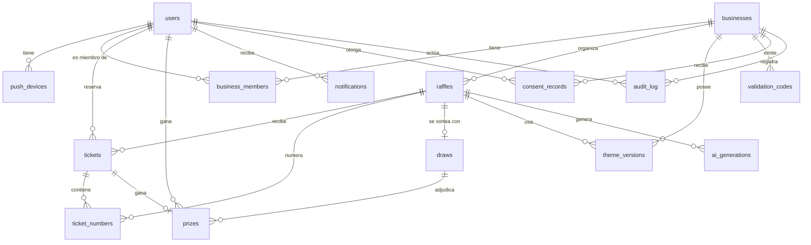

# Modelo de datos — Suertudo

> Esquema relacional de referencia. La fuente de verdad ejecutable son las migraciones en `services/db/migrations/`; este documento explica **por qué** el esquema es así.
>
> Motor: **PostgreSQL 16**.acceso con `sqlx` (compile-time checked).

---

## 1. Panorama



**Lectura del diagrama:** las dos tablas que sostienen el producto son `raffles` (el sorteo) y `tickets` (la reserva). Todo lo demás cuelga de ellas.

---

## 2. Convenciones

| Convención | Regla |
|---|---|
| Clave primaria | `uuid` generado por la app (`gen_random_uuid()` de `pgcrypto`). Evita adivinar IDs y filtra datos ajenos. |
| Timestamps | `timestamptz`, siempre en UTC. Se convierte a `America/Argentina/Buenos_Aires` en la capa de presentación. |
| Dinero | `numeric(12,2)` + `char(3)` de moneda. El MVP no tiene dinero de participantes, pero los planes de suscripción sí. |
| Texto libre | `text` + longitud máxima en el validador de la API, no en la base. |
| Soft delete | `deleted_at timestamptz` solo en tablas con datos históricos que deben sobrevivir a la baja (`users`, `businesses`, `raffles`). El resto se borra de verdad. |
| Enumeraciones | `text` con `CHECK`, no tipos ENUM de Postgres: agregar un valor no requiere `ALTER TYPE` bloqueante. |
| Nombres | `snake_case`, singulares, en inglés (consistencia con el código y los campos JSON de la API). |
| UUID vs bigint | `uuid` en entidades expuestas al cliente; `bigserial` no se usa. |

---

## 3. Entidades

### 3.1 `users` — participantes

```sql
CREATE TABLE users (
    id                uuid PRIMARY KEY DEFAULT gen_random_uuid(),
    email             citext NOT NULL UNIQUE,
    phone_e164        text UNIQUE,
    display_name      text NOT NULL,
    password_hash     text,                       -- NULL para magic link / SSO
    role              text NOT NULL DEFAULT 'participant'
                      CHECK (role IN ('participant','business_owner','platform_admin')),
    status            text NOT NULL DEFAULT 'active'
                      CHECK (status IN ('active','pending_review','suspended','deleted')),
    locale            text NOT NULL DEFAULT 'es-AR',
    timezone          text NOT NULL DEFAULT 'America/Argentina/Buenos_Aires',
    marketing_opt_in  boolean NOT NULL DEFAULT false,
    -- Consentimiento granular por negocio: ver consent_records
    last_login_at     timestamptz,
    created_at        timestamptz NOT NULL DEFAULT now(),
    updated_at        timestamptz NOT NULL DEFAULT now(),
    deleted_at        timestamptz
);

CREATE INDEX users_email_lower_idx ON users (lower(email));
CREATE INDEX users_status_idx ON users (status) WHERE deleted_at IS NULL;
```

**Notas de diseño**

- `email` es `citext` para que el login no dependa de mayúsculas. La unicidad real la garantiza el índice de expresión.
- `status = 'pending_review'` es el estado de las cuentas creadas en masa (anti-abuso, `FR-PA-10`). Un usuario en este estado **no** puede reservar números.
- `marketing_opt_in` es el **default global** del usuario. El consentimiento **por negocio** vive en `consent_records`: un usuario puede querer recibir promos de la pizzería y no del gym.

### 3.2 `push_devices`

```sql
CREATE TABLE push_devices (
    id          uuid PRIMARY KEY DEFAULT gen_random_uuid(),
    user_id     uuid NOT NULL REFERENCES users(id) ON DELETE CASCADE,
    platform    text NOT NULL CHECK (platform IN ('android','ios','web')),
    token       text NOT NULL UNIQUE,
    app_version text,
    active      boolean NOT NULL DEFAULT true,
    created_at  timestamptz NOT NULL DEFAULT now(),
    last_seen_at timestamptz
);

CREATE INDEX push_devices_user_idx ON push_devices (user_id) WHERE active;
```

El token es único globalmente: un mismo token no puede apuntar a dos usuarios (cambio de teléfono, logout mal limpo). Cuando FCM/APNs responde `Unregistered`, el worker marca `active = false` en vez de borrar, para preservar el histórico.

### 3.3 `businesses` — comercios

```sql
CREATE TABLE businesses (
    id                uuid PRIMARY KEY DEFAULT gen_random_uuid(),
    slug              text NOT NULL UNIQUE,
    name              text NOT NULL,
    tax_id            text,                    -- CUIT, ver SUPUESTO-3
    category          text NOT NULL,           -- taxonomy libre v1: 'restaurant','cafe','beauty','other'
    description       text,
    logo_url          text,
    cover_url         text,
    -- Tokens de marca: anclas fijas que la IA no puede tocar
    brand_primary     text NOT NULL DEFAULT '#1E5F74',
    brand_secondary   text NOT NULL DEFAULT '#F2A65A',
    brand_font_display text NOT NULL DEFAULT 'serif',
    brand_font_body    text NOT NULL DEFAULT 'sans',
    address_line      text,
    city              text,
    province          text,
    -- Mercado
    plan              text NOT NULL DEFAULT 'starter'
                      CHECK (plan IN ('starter','pro','business')),
    plan_status       text NOT NULL DEFAULT 'active'
                      CHECK (plan_status IN ('active','past_due','cancelled')),
    plan_renews_at    timestamptz,
    -- Moderación
    status            text NOT NULL DEFAULT 'active'
                      CHECK (status IN ('pending','active','suspended','rejected')),
    created_at        timestamptz NOT NULL DEFAULT now(),
    updated_at        timestamptz NOT NULL DEFAULT now(),
    deleted_at        timestamptz
);

CREATE INDEX businesses_status_idx ON businesses (status) WHERE deleted_at IS NULL;
CREATE INDEX businesses_plan_idx ON businesses (plan, plan_status);
```

**Por qué los tokens de marca están en la tabla y no en un JSON:** son el contrato con la IA (`FR-AI-03`) y con el renderer. Si fueran un JSON libre, cada consumidor tendría que interpretarlo y la garantía de "anclas fijas" se vuelve una convención social en vez de una restricción de esquema.

**Por qué `plan` está en la tabla y no en una tabla de suscripciones:** el MVP no cobra automáticamente (`SUPUESTO-3`); el estado del plan lo actualiza un proceso manual o, en Fase 2, el proceso de facturación. La tabla `subscriptions` se agrega en Fase 2 sin romper nada.

### 3.4 `business_members`

```sql
CREATE TABLE business_members (
    id           uuid PRIMARY KEY DEFAULT gen_random_uuid(),
    business_id  uuid NOT NULL REFERENCES businesses(id) ON DELETE CASCADE,
    user_id      uuid NOT NULL REFERENCES users(id) ON DELETE CASCADE,
    role         text NOT NULL CHECK (role IN ('owner','admin','staff','analyst')),
    status       text NOT NULL DEFAULT 'active'
                 CHECK (status IN ('invited','active','revoked')),
    invited_by   uuid REFERENCES users(id),
    created_at   timestamptz NOT NULL DEFAULT now(),
    UNIQUE (business_id, user_id)
);

CREATE INDEX business_members_user_idx ON business_members (user_id) WHERE status = 'active';
```

**Roles y permisos** (ver §3 del PRD):

| Rol | Puede |
|---|---|
| `owner` | Todo, incluida la baja del negocio y la transferencia de propiedad. |
| `admin` | Crear/editar/publicar sorteos, gestionar miembros, ver/exportar participantes. |
| `staff` | Validar códigos, marcar premios como entregados, ver participantes. **No** puede exportar ni editar sorteos. |
| `analyst` | Solo lectura de métricas y participantes anonimizados. |

### 3.5 `raffles` — el sorteo

```sql
CREATE TABLE raffles (
    id                uuid PRIMARY KEY DEFAULT gen_random_uuid(),
    business_id       uuid NOT NULL REFERENCES businesses(id) ON DELETE CASCADE,
    public_id         uuid NOT NULL DEFAULT gen_random_uuid() UNIQUE,  -- id público (share link)
    slug              text NOT NULL,                                  -- legible, único por business
    title             text NOT NULL,
    subtitle          text,
    description       text,
    rules_md          text,
    -- Premio
    prize_name        text NOT NULL,
    prize_description text,
    prize_quantity    integer NOT NULL DEFAULT 1 CHECK (prize_quantity > 0),
    prize_delivery_instructions text,
    prize_image_url   text,
    category          text NOT NULL DEFAULT 'other',
    -- Configuración del sorteo
    status            text NOT NULL DEFAULT 'draft'
                      CHECK (status IN ('draft','published','closed','drawn','settled','void','archived')),
    participation_mode text NOT NULL DEFAULT 'open'
                      CHECK (participation_mode IN ('open','validated')),
    draw_source       text NOT NULL DEFAULT 'own_draw'
                      CHECK (draw_source IN ('own_draw','external_lottery')),
    draw_unit         text NOT NULL DEFAULT 'number'
                      CHECK (draw_unit IN ('number','ticket')),
    no_winner_policy  text NOT NULL DEFAULT 'redraw'
                      CHECK (no_winner_policy IN ('redraw','shared_prize','void')),
    number_pool_size  integer NOT NULL DEFAULT 1000 CHECK (number_pool_size BETWEEN 10 AND 1000000),
    numbers_per_ticket_min integer NOT NULL DEFAULT 1 CHECK (numbers_per_ticket_min >= 1),
    numbers_per_ticket_max integer NOT NULL DEFAULT 5,
    max_tickets_per_user   integer NOT NULL DEFAULT 1 CHECK (max_tickets_per_user >= 1),
    min_coverage_pct numeric(5,2) NOT NULL DEFAULT 0,
    -- Fechas
    opens_at          timestamptz,
    closes_at         timestamptz,
    draws_at          timestamptz,
    published_at      timestamptz,
    closed_at         timestamptz,
    drawn_at          timestamptz,
    settled_at        timestamptz,
    -- Presentación
    theme_id          uuid REFERENCES theme_versions(id),
    cover_image_url   text,
    -- Métricas desnormalizadas (mantenidas por el worker de draws)
    tickets_count     integer NOT NULL DEFAULT 0,
    numbers_reserved  integer NOT NULL DEFAULT 0,
    -- Control
    created_at        timestamptz NOT NULL DEFAULT now(),
    updated_at        timestamptz NOT NULL DEFAULT now(),
    deleted_at        timestamptz,
    UNIQUE (business_id, slug),
    CONSTRAINT raffles_dates_ck CHECK (
        (closes_at IS NULL OR draws_at IS NULL) OR draws_at >= closes_at
    ),
    CONSTRAINT raffles_theme_fk FOREIGN KEY (theme_id) REFERENCES theme_versions(id)
);

CREATE INDEX raffles_status_closes_idx ON raffles (status, closes_at) WHERE deleted_at IS NULL;
CREATE INDEX raffles_business_idx ON raffles (business_id, created_at DESC) WHERE deleted_at IS NULL;
CREATE INDEX raffles_draws_at_idx ON raffles (draws_at) WHERE status = 'closed';
CREATE INDEX raffles_category_idx ON raffles (category, status) WHERE deleted_at IS NULL;
```

**Decisiones que vale la pena explicar**

| Campo | Por qué |
|---|---|
| `public_id` además de `id` | El `id` interno puede filtrar información (volumen, fechas). El `public_id` es lo que va en los links y en las URLs públicas. |
| `draw_source` con un solo valor implementado | Es la costura para el adaptador de lotería externa (Fase 3). El campo existe desde el día 1 para no tener que migrar datos después. Ver `R3` en el PRD. |
| `numbers_per_ticket_min/max` en vez de un solo número | Permite "1 número" (estilo lotería) o "5 números" (estilo bingo) con el mismo modelo. |
| `tickets_count` / `numbers_reserved` desnormalizados | El feed público muestra "quedan N números" en cada card. Calcularlo con un `COUNT` en cada listado no escala. Se actualiza en la misma transacción que inserta el ticket. |
| `min_coverage_pct` | Configurable por negocio. Si se supera, se avisa al comercio (no bloquea el sorteo; ver §7.3 del PRD). |
| `theme_id` apunta a `theme_versions` | El tema es versionado e inmutable; apuntar a una versión concreta (y no a un "tema actual") hace que el sorteo sea reproducible. |

### 3.6 `tickets` — la reserva

```sql
CREATE TABLE tickets (
    id                uuid PRIMARY KEY DEFAULT gen_random_uuid(),
    raffle_id         uuid NOT NULL REFERENCES raffles(id) ON DELETE CASCADE,
    user_id           uuid REFERENCES users(id) ON DELETE SET NULL,  -- NULL si el usuario se dio de baja
    business_id       uuid NOT NULL REFERENCES businesses(id) ON DELETE CASCADE,
    code              text NOT NULL UNIQUE,        -- SU-TKU4F9K
    numbers_count     integer NOT NULL CHECK (numbers_count > 0),
    status            text NOT NULL DEFAULT 'reserved'
                      CHECK (status IN ('reserved','winner','not_winner','cancelled')),
    validation_code_id uuid REFERENCES validation_codes(id),
    auto_picked       boolean NOT NULL DEFAULT false,
    source            text NOT NULL DEFAULT 'app'
                      CHECK (source IN ('app','web','admin')),
    ip_hash           text,                        -- hash, no la IP cruda
    user_agent        text,
    created_at        timestamptz NOT NULL DEFAULT now(),
    updated_at        timestamptz NOT NULL DEFAULT now(),
    cancelled_at      timestamptz
);

CREATE INDEX tickets_user_idx ON tickets (user_id, created_at DESC) WHERE status <> 'cancelled';
CREATE INDEX tickets_raffle_idx ON tickets (raffle_id, status);
CREATE INDEX tickets_business_idx ON tickets (business_id, created_at DESC);
CREATE UNIQUE INDEX tickets_user_raffle_limit_idx
    ON tickets (raffle_id, user_id) WHERE status <> 'cancelled';
```

**`business_id` desnormalizado en `tickets`:** existe por un motivo concreto de performance y de aislamiento. Casi toda consulta de negocio es "dame los tickets de este sorteo de este business", y desnormalizar evita un join en el camino caliente. **La invariante es dura: `tickets.business_id` DEBE ser igual a `raffles.business_id`.** Se garantiza con un trigger de Postgres:

```sql
CREATE FUNCTION enforce_ticket_business_match() RETURNS trigger AS $$
BEGIN
    IF (SELECT business_id FROM raffles WHERE id = NEW.raffle_id) <> NEW.business_id THEN
        RAISE EXCEPTION 'ticket.business_id must match raffle.business_id';
    END IF;
    RETURN NEW;
END;
$$ LANGUAGE plpgsql;

CREATE TRIGGER tickets_business_match_trg
    BEFORE INSERT OR UPDATE ON tickets
    FOR EACH ROW EXECUTE FUNCTION enforce_ticket_business_match();
```

**El límite de tickets por participante lo hace el trigger `tickets_max_per_user_trg`, no el índice.** Un índice único parcial con la forma `UNIQUE (raffle_id, user_id)` fija el límite en **uno**: no puede expresar "este sorteo permite dos" ni "este sorteo permite cinco". El trigger cuenta los tickets vivos del participante para ese sorteo, **bajo el lock de la fila del sorteo** —el mismo lock que usa la reserva—, y lo compara con `raffles.max_tickets_per_user`. El índice se conservó como el piso de uno y la migración `0031` lo cambió por un índice no único.

El orden importa: la reserva toma el lock del sorteo, y el trigger cuenta bajo ese mismo lock. Sin el lock, dos reservas concurrentes podrían contar el mismo número de tickets y las dos pasarían.

**`ip_hash`:** se guarda el hash con salt rotativo, no la IP. Sirve para rate limiting y anti-abuso sin retener un dato personal identificable en claro.

### 3.7 `ticket_numbers` — los números

```sql
CREATE TABLE ticket_numbers (
    id          uuid PRIMARY KEY DEFAULT gen_random_uuid(),
    ticket_id   uuid NOT NULL REFERENCES tickets(id) ON DELETE CASCADE,
    raffle_id   uuid NOT NULL REFERENCES raffles(id) ON DELETE CASCADE,
    number      integer NOT NULL CHECK (number >= 0),
    created_at  timestamptz NOT NULL DEFAULT now(),
    UNIQUE (raffle_id, number)
);

CREATE INDEX ticket_numbers_ticket_idx ON ticket_numbers (ticket_id);
CREATE INDEX ticket_numbers_raffle_number_idx ON ticket_numbers (raffle_id, number);
```

**La restricción `UNIQUE (raffle_id, number)` es la pieza central de la integridad del producto.** Es lo que garantiza que dos participantes no puedan tener el mismo número y que un número ganador sea único. `FR-PA-03` es directamente esta constraint.

**Atomicidad de la reserva:** la inserción del ticket y la de sus números ocurren en la misma transacción. Si un número está tomado, la transacción completa se revierte y no queda un ticket a medias. `FR-PA-03` lo exige explícitamente.

**Numeración por sorteo:** no hay tabla de pool. El pool es implícito: `0 .. number_pool_size - 1`. Los números disponibles se calculan como `number_pool_size - COUNT(ticket_numbers WHERE raffle_id = X)`. Agregar una tabla de pool seríaormalizar algo que nunca se consulta solo.

### 3.8 `draws` — el resultado

```sql
CREATE TABLE draws (
    id                uuid PRIMARY KEY DEFAULT gen_random_uuid(),
    raffle_id         uuid NOT NULL UNIQUE REFERENCES raffles(id) ON DELETE CASCADE,
    business_id       uuid NOT NULL REFERENCES businesses(id) ON DELETE CASCADE,
    -- Compromiso (público desde la publicación)
    seed_commitment   text NOT NULL,           -- hex(SHA-256(seed))
    algorithm         text NOT NULL DEFAULT 'hmac-sha256/v1',
    derivation_spec   jsonb NOT NULL,          -- { message_template, hash, mod }
    -- Semilla (cifrada hasta el revelado)
    seed_ciphertext   bytea NOT NULL,          -- AES-256-GCM
    seed_revealed     boolean NOT NULL DEFAULT false,
    revealed_at       timestamptz,
    -- Resultado
    draw_index        integer NOT NULL DEFAULT 0,
    attempts          integer NOT NULL DEFAULT 0,
    pool_size         integer NOT NULL,
    winning_numbers   integer[] NOT NULL DEFAULT '{}',
    status            text NOT NULL DEFAULT 'pending'
                      CHECK (status IN ('pending','executed','failed','voided')),
    executed_at       timestamptz,
    executed_by       uuid REFERENCES users(id),   -- NULL si fue automático
    execution_mode    text NOT NULL DEFAULT 'auto'
                      CHECK (execution_mode IN ('auto','manual','redraw')),
    error             text,
    created_at        timestamptz NOT NULL DEFAULT now()
);

CREATE INDEX draws_raffle_idx ON draws (raffle_id);
CREATE INDEX draws_status_idx ON draws (status) WHERE status = 'pending';
```

**El par `seed_commitment` / `seed_ciphertext` es el corazón de la confianza.**

- `seed_commitment` se escribe **al publicar** el sorteo, junto con `raffles.status = 'published'`. Es público desde ese instante.
- `seed_ciphertext` guarda la misma semilla, cifrada con AES-256-GCM usando una clave que el worker de draws obtiene del secret manager. La clave **nunca** está en la base.
- Al ejecutar, el worker descifra, deriva, y **marca `seed_revealed = true` y escribe `revealed_at`**. La fila pasa a ser pública.
- El `UNIQUE (raffle_id)` garantiza `FR-DR-01`: un solo draw por sorteo, sin importar cuántas ejecuciones concurrentes lleguen.

**`winning_numbers` es un array, no una tabla:** un sorteo puede tener varios premios y por lo tanto varios números ganadores. La relación con los tickets se resuelve en `prizes`.

**`derivation_spec` en JSONB:** guarda la fórmula aplicada (`message_template`, `hash`, `mod`) junto al resultado. Si mañana se cambia la fórmula, cada sorteo conserva la suya y la verificación pública sigue siendo exacta. Es la diferencia entre "el resultado es auditable" y "el resultado es auditable *según la versión de la fórmula de la semana que se implementó*".

### 3.9 `prizes` — premios y entrega

```sql
CREATE TABLE prizes (
    id                uuid PRIMARY KEY DEFAULT gen_random_uuid(),
    raffle_id         uuid NOT NULL REFERENCES raffles(id) ON DELETE CASCADE,
    draw_id           uuid NOT NULL REFERENCES draws(id) ON DELETE CASCADE,
    ticket_id         uuid REFERENCES tickets(id),
    user_id           uuid REFERENCES users(id) ON DELETE SET NULL,
    business_id       uuid NOT NULL REFERENCES businesses(id) ON DELETE CASCADE,
    prize_name        text NOT NULL,
    prize_description text,
    winning_number    integer,
    status            text NOT NULL DEFAULT 'pending'
                      CHECK (status IN ('pending','claimed','delivered','expired','unassigned','voided')),
    unassigned_reason text,                     -- 'no_winner', 'no_prize_remaining'
    claim_code        text UNIQUE,              -- código que el ganador usa para canjear en el local
    claimed_at        timestamptz,
    delivered_at      timestamptz,
    delivery_notes    text,
    delivery_evidence_url text,
    expires_at        timestamptz,
    created_at        timestamptz NOT NULL DEFAULT now(),
    updated_at        timestamptz NOT NULL DEFAULT now()
);

CREATE UNIQUE INDEX prizes_raffle_position_idx ON prizes (raffle_id, prize_name)
    WHERE status <> 'voided';
CREATE INDEX prizes_user_idx ON prizes (user_id, status) WHERE user_id IS NOT NULL;
CREATE INDEX prizes_business_status_idx ON prizes (business_id, status);
CREATE INDEX prizes_expiry_idx ON prizes (expires_at) WHERE status = 'pending';
```

**`claim_code`:** el ganador canjea su premio en el local con un código, igual que un ticket. El comercio lo escanea o lo ingresa en el panel. Es el nexo entre el mundo físico y el digital, y es lo que permite al negocio demostrar que entregó.

**`unassigned_reason`:** un sorteo puede tener más premios que ganadores. El sobrante queda explícito con motivo, en vez de desaparecer. `FR-RA-08`.

**Índice `prizes_raffle_position_idx`:** evita el caso "el mismo premio entregado dos veces" por una condición de carrera entre dos operadores del negocio.

### 3.10 `theme_versions` — temas visuales

```sql
CREATE TABLE theme_versions (
    id            uuid PRIMARY KEY DEFAULT gen_random_uuid(),
    business_id   uuid NOT NULL REFERENCES businesses(id) ON DELETE CASCADE,
    raffle_id     uuid REFERENCES raffles(id) ON DELETE CASCADE,   -- NULL = tema de negocio
    version       integer NOT NULL,
    source        text NOT NULL CHECK (source IN ('ai','manual','default','preset')),
    prompt        text,
    prompt_hash   text,
    spec          jsonb NOT NULL,          -- theme_spec validado
    warnings      jsonb NOT NULL DEFAULT '[]',
    is_active     boolean NOT NULL DEFAULT false,
    model         text,                    -- modelo usado, si source = 'ai'
    created_by    uuid REFERENCES users(id),
    created_at    timestamptz NOT NULL DEFAULT now(),
    UNIQUE (raffle_id, version)
);

CREATE INDEX theme_versions_raffle_idx ON theme_versions (raffle_id, version DESC);
CREATE UNIQUE INDEX theme_versions_one_active_idx
    ON theme_versions (raffle_id) WHERE is_active AND raffle_id IS NOT NULL;
```

**El `spec` en JSONB validado contra un JSON Schema** (definido en [`ai-spec.md`](./ai-spec.md)) es lo que permite que el mismo tema se renderice idéntico en Flutter y en Next.js. La validación ocurre **antes** de escribir: un `spec` inválido nunca entra a la base.

**El índice único parcial `theme_versions_one_active_idx`** garantiza que hay **a lo sumo un tema activo** por sorteo. Es la regla que hace que el rollback (`FR-AI-07`) sea una transacción simple: activar la v1 desactiva la v3 en el mismo `UPDATE`.

**`raffle_id IS NULL` = tema de negocio:** el negocio puede tener un tema por defecto que se aplica a los sorteos nuevos, y así el "kit de marca" es reutilizable.

### 3.11 `ai_generations` — trazabilidad de la IA

```sql
CREATE TABLE ai_generations (
    id             uuid PRIMARY KEY DEFAULT gen_random_uuid(),
    business_id    uuid NOT NULL REFERENCES businesses(id) ON DELETE CASCADE,
    raffle_id      uuid REFERENCES raffles(id) ON DELETE CASCADE,
    theme_version_id uuid REFERENCES theme_versions(id),
    prompt         text NOT NULL,
    prompt_hash    text NOT NULL,
    model          text NOT NULL,
    status         text NOT NULL DEFAULT 'pending'
                   CHECK (status IN ('pending','running','succeeded','failed','rejected')),
    attempt_count  integer NOT NULL DEFAULT 0,
    tokens_in      integer,
    tokens_out     integer,
    cost_usd       numeric(10,6),
    latency_ms     integer,
    validation_errors jsonb,
    error_code     text,
    created_at     timestamptz NOT NULL DEFAULT now(),
    completed_at   timestamptz
);

CREATE INDEX ai_generations_hash_idx ON ai_generations (prompt_hash, created_at DESC);
CREATE INDEX ai_generations_status_idx ON ai_generations (status) WHERE status IN ('pending','running');
```

**Existe por dos motivos concretos:**

1. **Cache.** `prompt_hash` + `brand_tokens_hash` + contexto determinan el resultado. Un índice sobre `prompt_hash` permite el hit de cache de `FR-AI-10`.
2. **Auditoría de calidad.** `validation_errors` guarda por qué se rechazó una generación. Sin esto, no se puede responder "¿por qué la IA falló?" cuando el comercio reporta un tema raro. Es la base de las métricas de `NFR-AI-02` y `NFR-AI-03`.

**Prompt y prompt en claro:** el prompt es del negocio y puede contener información de su producto. No se envía PII de participantes al modelo (`NFR-AI-06`).

### 3.12 `notifications`

```sql
CREATE TABLE notifications (
    id            uuid PRIMARY KEY DEFAULT gen_random_uuid(),
    user_id       uuid NOT NULL REFERENCES users(id) ON DELETE CASCADE,
    business_id   uuid REFERENCES businesses(id) ON DELETE CASCADE,  -- NULL = notificación de plataforma
    raffle_id     uuid REFERENCES raffles(id) ON DELETE CASCADE,
    type          text NOT NULL,
                  -- 'you_won','prize_claimed','prize_delivered','raffle_closing_soon',
                  -- 'raffle_voided','ticket_confirmed','business_message','marketing'
    channel       text NOT NULL CHECK (channel IN ('push','email','in_app','whatsapp')),
    payload       jsonb NOT NULL,
    dedupe_key    text NOT NULL UNIQUE,     -- sha1(user_id + type + entity_id)
    status        text NOT NULL DEFAULT 'queued'
                  CHECK (status IN ('queued','sending','sent','failed','skipped')),
    scheduled_at  timestamptz NOT NULL DEFAULT now(),
    sent_at       timestamptz,
    read_at       timestamptz,
    error         text,
    created_at    timestamptz NOT NULL DEFAULT now()
);

CREATE INDEX notifications_user_idx ON notifications (user_id, created_at DESC);
CREATE INDEX notifications_pending_idx ON notifications (status) WHERE status = 'queued';
CREATE INDEX notifications_unscheduled_idx ON notifications (scheduled_at) WHERE status = 'queued';
```

**`dedupe_key` con `UNIQUE`:** implementa `FR-NO-03` (idempotencia) **en la base**. El worker puede reintentar sin miedo: la inserción duplicada falla y se descarta.

**`status = 'skipped'`:** un push a un usuario sin token de push no es un error; queda `skipped` y el email sigue su curso. Así el dashboard de entrega es honesto.

### 3.13 `consent_records` — consentimiento granular

```sql
CREATE TABLE consent_records (
    id           uuid PRIMARY KEY DEFAULT gen_random_uuid(),
    user_id      uuid NOT NULL REFERENCES users(id) ON DELETE CASCADE,
    business_id  uuid NOT NULL REFERENCES businesses(id) ON DELETE CASCADE,
    scope        text NOT NULL CHECK (scope IN ('share_marketing','share_contact','participation')),
    granted      boolean NOT NULL,
    source       text NOT NULL CHECK (source IN ('signup','participation','settings','business_message')),
    ip_hash      text,
    user_agent   text,
    created_at   timestamptz NOT NULL DEFAULT now()
);

CREATE INDEX consent_records_lookup_idx ON consent_records (user_id, business_id, scope, created_at DESC);
CREATE INDEX consent_records_business_idx ON consent_records (business_id) WHERE granted AND scope = 'share_marketing';
```

**`consent_records` es append-only**: cada cambio de preferencia agrega una fila nueva. El estado actual es el **último registro por `(user, business, scope)`**. Guardar solo el estado booleano perdería la trazabilidad que exige `FR-PR-02` (reconstruir cuándo y desde dónde se dio el consentimiento).

**Índice `consent_records_business_idx`:** es el índice que hace que el export CSV de un negocio con 50 000 participantes no se degrade. Es un índice parcial sobre exactamente la consulta que se ejecuta en el camino caliente del producto de monetización.

### 3.14 `validation_codes` — códigos de un solo uso

```sql
CREATE TABLE validation_codes (
    id           uuid PRIMARY KEY DEFAULT gen_random_uuid(),
    business_id  uuid NOT NULL REFERENCES businesses(id) ON DELETE CASCADE,
    raffle_id    uuid NOT NULL REFERENCES raffles(id) ON DELETE CASCADE,
    code         text NOT NULL UNIQUE,
    status       text NOT NULL DEFAULT 'unused'
                 CHECK (status IN ('unused','used','revoked')),
    used_at      timestamptz,
    used_by_ticket_id uuid REFERENCES tickets(id),
    created_at   timestamptz NOT NULL DEFAULT now()
);

CREATE INDEX validation_codes_raffle_idx ON validation_codes (raffle_id, status);
```

### 3.15 `audit_log` — auditoría

```sql
CREATE TABLE audit_log (
    id            bigserial PRIMARY KEY,
    business_id   uuid REFERENCES businesses(id) ON DELETE SET NULL,
    actor_user_id uuid REFERENCES users(id) ON DELETE SET NULL,
    actor_type    text NOT NULL CHECK (actor_type IN ('user','system','api_key')),
    action        text NOT NULL,        -- 'raffle.published','participants.exported','theme.activated',...
    entity_type   text NOT NULL,
    entity_id     text NOT NULL,
    before        jsonb,
    after         jsonb,
    metadata      jsonb NOT NULL DEFAULT '{}',
    ip_hash       text,
    created_at    timestamptz NOT NULL DEFAULT now()
);

CREATE INDEX audit_log_business_idx ON audit_log (business_id, created_at DESC);
CREATE INDEX audit_log_entity_idx ON audit_log (entity_type, entity_id);
CREATE INDEX audit_log_actor_idx ON audit_log (actor_user_id, created_at DESC);
```

**Append-only:** no hay `UPDATE` ni `DELETE` sobre esta tabla. UnaTrigger de Postgres la bloquea:

```sql
CREATE RULE audit_log_no_update AS ON UPDATE TO audit_log DO INSTEAD NOTHING;
CREATE RULE audit_log_no_delete AS ON DELETE TO audit_log DO INSTEAD NOTHING;
```

`before`/`after` guardan el diff de los campos que cambian, no el objeto completo. Un cambio de estado de sorteo no necesita arrastrar la descripción entera del premio.

**Retención: 2 años** (`NFR-SE-09`), con un job que anonimiza los `actor_user_id` de usuarios dados de baja.

### 3.16 Tablas de soporte

```sql
-- Lotes de números: para sorteos de un negocio con pool grande y needing cobertura
CREATE TABLE number_reservations_audit (   -- opcional, Fase 2
    id         bigserial PRIMARY KEY,
    raffle_id  uuid NOT NULL REFERENCES raffles(id) ON DELETE CASCADE,
    number     integer NOT NULL,
    action     text NOT NULL CHECK (action IN ('reserved','released','won')),
    created_at timestamptz NOT NULL DEFAULT now()
);

-- Registro de la cola de mensajes de la plataforma (no confundir con notifications)
CREATE TABLE outbox (
    id            uuid PRIMARY KEY DEFAULT gen_random_uuid(),
    topic         text NOT NULL,
    payload       jsonb NOT NULL,
    published_at  timestamptz,
    created_at    timestamptz NOT NULL DEFAULT now()
);
CREATE INDEX outbox_pending_idx ON outbox (created_at) WHERE published_at IS NULL;
```

**La tabla `outbox` es el patrón de transactional outbox**: cuando el worker de draws crea un premio y necesita notificar, escribe el evento en `outbox` **dentro de la misma transacción** que confirma el sorteo. Un proceso aparte lo publica a la cola de iii. Esto garantiza que "el sorteo se ejecutó" y "se encoló la notificación" sean atómicos — sin el outbox, un crash entre ambas deja al ganador sin avisar.

### 3.17 `auth_tokens` — magic links y familias de refresh

> **Añadida en la migración `0013_identity_tokens.sql`.** El esquema inicial no la tenía y el trabajo de identidad la necesita: el access token es un JWT sin estado, pero el magic link tiene que ser de un solo uso y el refresh token tiene que rotar con su familia revocada.

```sql
CREATE TABLE auth_tokens (
    id           uuid PRIMARY KEY DEFAULT gen_random_uuid(),
    user_id      uuid REFERENCES users(id) ON DELETE CASCADE,
    email        citext NOT NULL,
    kind         text NOT NULL CHECK (kind IN ('magic_link','refresh')),
    token_hash   bytea NOT NULL,
    family_id    uuid,
    expires_at   timestamptz NOT NULL,
    consumed_at  timestamptz,
    revoked_at   timestamptz,
    created_at   timestamptz NOT NULL DEFAULT now(),
    ip_hash      text,
    user_agent   text
);
```

| Decisión | Razón |
|---|---|
| **`email` en la fila, `user_id` nullable** | Un magic link se emite **antes** de que el usuario exista: el registro se crea al consumirlo. El `email` es la identidad previa; el `user_id` se completa en ese momento. |
| **Solo el `token_hash`** | El token en claro existe una vez, en el email. Si la base se filtra, los tokens no son utilizables. |
| **`consumed_at` para el magic link, `revoked_at` para el refresh** | Un magic link se *consume*; un refresh se *revoca* al rotar. La fila sobrevive a las dos operaciones: es lo que permite detectar un reuso. |
| **`family_id`** | Agrupa la cadena de refresh. Un reuso revoca la familia entera (`FR-ID-04`). |

**Índices y qué invarian cada uno:**

| Índice | Invariante |
|---|---|
| `auth_tokens_hash_idx` (UNIQUE) | El hash de un token es único |
| `auth_tokens_magic_link_once_idx` (parcial, UNIQUE) | Un email tiene **un solo** magic link sin consumir |
| `auth_tokens_one_live_per_family_idx` (parcial, UNIQUE) | Una familia de refresh tiene **como máximo un token vivo** |

> **Corrección posterior a la implementación.** El índice original se llamaba `auth_tokens_refresh_successor_idx` y filtraba por `consumed_at IS NOT NULL`, lo que nunca se cumplía: la rotación marca `revoked_at`, no `consumed_at`. El índice era **muerto** y su comentario describía una invariante que no existe (una familia tiene tantos tokens como rotaciones). El índice correcto es `auth_tokens_one_live_per_family_idx`: impide que dos refresh concurrentes con el mismo token produzcan dos sucesores vivos.

### 3.18 Columnas añadidas a `users`

| Columna | Tipo | Razón |
|---|---|---|
| `notification_preferences` | `jsonb NOT NULL DEFAULT '{"push":true,"email":true,"marketing":false}'` | `marketing_opt_in` solo alcanzaba para el canal de marketing. Los canales operativos (push y email) necesitan su propio lugar: un participante puede rechazar el mail promocional y aun así querer el push que le avisa que ganó. La migración `0014_notification_preferences.sql` lo agrega con un `CHECK` que valida que las tres claves existan y sean booleanas. |
| `last_magic_link_at` | `timestamptz` | Marca la última emisión de un magic link. Todavía **no se usa**: el rate limit de `api-contract.md` §1.6 todavía no está implementado (ver `TSK-F0-09`). |

---

### 3.19 Desviaciones entre el documento y las migraciones

Estas diferencias aparecieron al implementar el esquema y están **corregidas en el código**. Se documentan para que el contrato y la base digan lo mismo.

| # | El documento decía | Lo que hace la migración | Por qué |
|---|---|---|---|
| 1 | `raffles.theme_id → theme_versions.id` y `tickets.validation_code_id → validation_codes.id` en la misma tabla | Las columnas se crean en `0004` / `0005` y las foreign keys en `0007` / `0009` | Son circulares: cada tabla se crea después de la otra. Los nombres son los del documento (`raffles_theme_fk`). |
| 2 | `users_email_lower_idx` es un índice de expresión | Es `CREATE UNIQUE INDEX` | La prosa dice que "la unicidad real la garantiza el índice de expresión"; un índice no único no garantiza nada. |
| 3 | §7.3 muestra RLS sobre dos tablas | RLS sobre **13** tablas, con dos excepciones públicas | `raffles` se puede leer cuando `status = 'published'` y `draws` cuando `seed_revealed = true`. Sin esas dos excepciones, el feed público y **la verificación pública del sorteo** —la promesa de confianza del producto— devolverían cero filas. |
| 4 | §6.4 compara el ticket contra el consentimiento concedido más reciente | Se compara contra el registro **más reciente** de cualquier tipo, y se exige que sea una concesión | La consulta impresa en §6.4 seguía exportando el contacto de un participante que **revocó** el consentimiento después de participar. El párrafo siguiente al SQL ya describía el comportamiento correcto; ahora el SQL lo hace. |
| 5 | `number_reservations_audit` en §3.16 | **No se crea** | §3.16 la marca "opcional, Fase 2" y §7.2 no la lista entre las 12 migraciones. |

### 3.20 El propietario de la tabla esquiva las políticas de RLS

**Postgres deja pasar al propietario de la tabla.** Una política de RLS no se le aplica a quien la posee, salvo que la tabla esté con `FORCE ROW LEVEL SECURITY`.

Consecuencias:

- **En producción, el rol de la API tiene que ser un rol sin propiedad sobre el esquema.** Si la API conecta como el dueño, el aislamiento no existe: la segunda barrera de `ADR-007` queda desactivada.
- **Los tests de RLS tienen que conectar con un rol que no sea el propietario.** El harness crea `suertudo_test_app` para eso. Un test que conecte como `suertudo` pasaría sin demostrar nada.

Las políticas **no** están con `FORCE`: el rol de la aplicación se crea en el despliegue, no en una migración, y una contraseña no pertenece a un archivo de esquema.

### 3.21 `sqlx::migrate!` embebe las migraciones al compilar

El macro `sqlx::migrate!("./migrations")` **incluye los archivos en el binario en tiempo de compilación**. Agregar un archivo `.sql` nuevo **no invalida el build**: el binario sigue aplicando el conjunto viejo, en silencio.

**Síntoma observado:** la migración `0013` se aplicaba a la base (la tabla existía) pero no aparecía en `_sqlx_migrations`, y `sqlx::migrate` fallaba después con `42P07 relation "auth_tokens" already exists`.

**Regla:** después de agregar o modificar una migración, hay que **forzar la recompilación** antes de aplicarla:

```bash
touch services/db/src/lib.rs
cargo build -p suertudo-db --bin suertudo-db
```

Y el smoke test tiene que comprobar que `SELECT max(version) FROM _sqlx_migrations` coincide con la cantidad de archivos `.sql` del directorio.

### 3.22 `token_families` — la muerte durable de una familia de refresh

> **Añadida en la migración `0018_token_families.sql`, reforzada en `0026_explicit_system_context.sql`.**

```sql
CREATE TABLE token_families (
    id             uuid PRIMARY KEY DEFAULT gen_random_uuid(),
    user_id        uuid NOT NULL REFERENCES users(id) ON DELETE CASCADE,
    created_at     timestamptz NOT NULL DEFAULT now(),
    revoked_at     timestamptz,
    revoke_reason  text
);
```

**Por qué hace falta una tabla propia.** Una familia de refresh era un conjunto de filas de `auth_tokens` con el mismo `family_id`, y la revocación marcaba esas filas. Eso no alcanza: una rotación concurrente puede insertar su sucesor **después** de la revocación, y el sucesor queda vivo. La familia deja de ser un conjunto de filas y pasa a ser **una fila con estado**, que es lo único que una revocación puede volver duradera.

| Decisión | Razón |
|---|---|
| **La familia tiene estado propio** | Una revocación que solo toca filas puede ser superada por un insert posterior. Una fila con `revoked_at` no. |
| **Un trigger rechaza el sucesor de una familia muerta** | SQLSTATE `55000`, mensaje `the refresh token family is revoked`. La garantía no depende de que la aplicación se acuerde de revisarla. |
| **Otro trigger revoca los tokens cuando la familia muere** | La familia es la fuente de verdad; las filas son la consecuencia. |
| **`revoke_reason`** | `logout`, `account_deleted`, `token_reuse`. La auditoría del por qué. |

### 3.23 `outbox.business_id`

> **Añadida en la migración `0022_outbox_rls.sql`.**

El outbox es el patrón de *transactional outbox* de `ADR-002` y su payload lleva datos de tenant. **Sin una columna que diga de quién es el evento, el aislamiento no se podía ni expresar.** La columna es nullable: los eventos de plataforma no pertenecen a un negocio.

### 3.24 Cinco hechos de Postgres que cambiaron el diseño

Los tres aparecieron al implementar el esquema y los tres se comportan de forma distinta a la intuición.

#### 1. Una política sin `WITH CHECK` concede escritura

Una política con solo `USING` **cae a `USING` para `INSERT` y `UPDATE`**. Las ramas públicas de lectura —`raffles.status = 'published'`, `draws.seed_revealed = true`— se convertían en permiso de escritura: un tenant podía insertar un sorteo publicado en el negocio de otro, o un sorteo con resultado forjado.

**Toda política de escritura lleva su `WITH CHECK`.** El `USING` decide qué se lee; el `WITH CHECK` decide qué se escribe.

#### 2. Un trigger que lee otra tabla queda filtrado por las políticas de esa tabla

`enforce_ticket_business_match()` hacía `SELECT business_id FROM raffles`. Con RLS activo y un contexto que no ve ese sorteo, el subquery devolvía `NULL`, y `NULL <> business_id` es `NULL`: el trigger **no** levantaba. La invariante era vacía exactamente en la configuración que el despliegue exige.

**Un trigger que necesita ver una fila que el llamador no puede ver tiene que ser `SECURITY DEFINER` con `search_path` fijo.** Y el sustituto declarativo —una foreign key compuesta `(raffle_id, business_id)`— es la garantía que sobrevive a cualquier cambio del trigger.

#### 3. Un `SET LOCAL` deja un placeholder vacío en la sesión

`set_config('app.user_id', $1, true)` dentro de una transacción revertisce el valor al terminar, pero **deja un placeholder vacío a nivel de sesión**. Con el contexto de sistema marcado como la cadena vacía, una conexión que ya corrió una transacción reportaba `is_system_context() = true` para siempre: medido, **1258 participantes visibles sin contexto** en una conexión reusada.

**El contexto de sistema tiene un marcador propio** (`'system'`), distinto de la cadena vacía. Ahora "sin contexto" (el GUC sin definir o con el placeholder vacío) y "contexto de sistema" son dos estados distintos, y el primero **falla cerrado**.

```sql
-- 0026_explicit_system_context.sql
CREATE OR REPLACE FUNCTION is_system_context() RETURNS boolean
    LANGUAGE sql STABLE AS $$
    SELECT COALESCE(current_setting('app.business_id', true), '') = 'system'
       AND COALESCE(current_setting('app.user_id', true), '') = 'system'
$$;
```

`current_business_id()` y `current_user_id()` tienen que ignorar el marcador: el sistema no es un tenant.

#### Un cuarto hecho, sobre el `UPDATE`

Un `UPDATE` exige que **la fila nueva** satisfaga tanto el `WITH CHECK` de las políticas de `UPDATE` como las políticas de `SELECT` de la tabla. Una fila anonimizada —`user_id = NULL`— deja de ser visible para el participante que la anonimiza, así que **no puede escribirla**. Por eso la anonimización es la función `anonymise_user_tickets(uuid)` (`SECURITY DEFINER`) y no un `UPDATE` común.

#### Y un quinto, sobre el `ON CONFLICT`

Un `INSERT` con un **arbiter** explícito (`ON CONFLICT (columna) WHERE ...`) hace que Postgres evalúe las políticas de `UPDATE` contra la fila nueva. Un magic link todavía no tiene dueño, así que la política de `UPDATE` lo rechaza y el `INSERT` falla con una violación de RLS. El `ON CONFLICT DO NOTHING` sin arbiter no lo hace.

**En `auth_tokens` no se usa un arbiter.** Es una restricción del esquema, no un detalle de la consulta.

### 3.25 Los SQLSTATE del dominio

La base rechaza con un código estable, y el worker lo traduce al código del catálogo de `docs/api-contract.md` §1.4. La traducción vive en `services/identity/src/adapters/mod.rs` (`storage_failure`) y en `domain::errors::Refusal`.

| SQLSTATE | Significado | HTTP | Código de §1.4 |
|---|---|---|---|
| `PT001` | El participante llegó al límite de tickets del sorteo | 409 | `TICKET_LIMIT_REACHED` |
| `PT002` | El sorteo no está abierto (es un `draft`) | 409 | `RAFFLE_NOT_OPEN` |
| `PT003` | El sorteo no acepta más reservas o cancelaciones | 409 | `RAFFLE_CLOSED` |
| `PT004` | El número ya está reservado | 409 | `NUMBER_TAKEN` |
| `PT005` | La cantidad de números está fuera de rango | 422 | `TICKET_SIZE_OUT_OF_RANGE` |
| `42501` | El que llama no es el dueño de la fila | 403 | `RBAC_FORBIDDEN` |
| `55000` | La familia de refresh está revocada | 401 | `AUTH_REQUIRED` |
| `23503` | La fila referenciada no existe | 404 | `NOT_FOUND` |
| `23505` | Violación de unicidad | 409 | `CONFLICT` |

**Un rechazo que se convierte en `500` es un rechazo que el cliente no puede manejar.** Por eso el SQLSTATE se traduce antes de llegar a la respuesta, y el mensaje de la base va a `details.reason` mientras el mensaje de la respuesta es el del catálogo, en español.

### 3.26 Las funciones que escriben una fila de tenant

Una tabla con `business_id` solo la escribe el dueño de la fila o la plataforma. Los caminos que legítimamente cruzan ese límite son funciones `SECURITY DEFINER` de cuerpo fijo, y **todas atan al que llama**: una función que muta una fila de tenant sin atar al que llama es una escritura cruzada sin límite.

| Función | Qué hace | Migración |
|---|---|---|
| `register_user(email, display_name)` | El alta del participante | `0023` |
| `find_user_by_email(email)` | Resuelve un correo en la fila del participante | `0023` |
| `find_token_by_hash(hash)` | Resuelve un hash de token en su fila | `0023` |
| `consume_magic_link(id)` | Consume el enlace mágico una sola vez | `0023` |
| `bind_magic_link_user(id, user_id)` | Asocia el enlace consumido con la cuenta | `0023` |
| `revoke_pending_magic_links(email)` | Revoca los enlaces pendientes de un correo | `0023` |
| `register_business(slug, name, category, user_id)` | El alta del negocio con su dueño | `0028` |
| `insert_magic_link(email, hash, expires_at)` | La emisión del enlace mágico | `0028` |
| `register_push_device(user_id, platform, token, app_version)` | El alta de un dispositivo | `0029` |
| `record_consent(user_id, business_id, scope, granted, source, user_agent)` | El consentimiento, append-only | `0028` |
| `reserve_ticket(raffle_id, user_id, code, numbers[])` | La reserva atómica de números | `0028` |
| `create_prize(raffle_id, draw_id, business_id, user_id, name, winning_number)` | El premio sobre un sorteo ya sorteado | `0028` |
| `apply_reservation_counters(ticket_id)` | **Recalcula** los contadores del sorteo desde la verdad | `0032` |
| `anonymise_user_tickets(user_id)` | Anonimiza los tickets de un participante | `0020` |
| `anonymise_user_devices(user_id)` | Anonimiza los dispositivos de un participante | `0029` |

**`apply_reservation_counters` recalcula, no incrementa.** Un contador que se recalcula desde la verdad no puede desviarse y es idempotente por construcción; uno que se incrementa puede ser movido por cualquiera que pueda llamar a la función.

### 3.27 Lo que falta: `claim_prize`

`FR-DR-08` y `POST /v1/me/prizes/{prize_id}/claim` **no tienen camino todavía**. Con `prizes_update` atada al dueño del negocio, el ganador no puede mover su propio premio de `pending` a `claimed`.

La función que falta, con la forma de las de `0028`:

```sql
claim_prize(p_prize_id uuid, p_user_id uuid, p_claim_code text) RETURNS void
```

| Requisito | Cómo se cumple |
|---|---|
| El premio es del que reclama | `SELECT … FOR UPDATE` y `user_id = p_user_id`; si no, `23503` → `404 NOT_FOUND` |
| El que llama es el dueño | `42501` → `403 RBAC_FORBIDDEN` |
| El premio se puede reclamar | `status = 'pending' AND claimed_at IS NULL`; si no, un SQLSTATE nuevo → `409 CONFLICT` |
| El código de canje es único | `claim_code` es `UNIQUE`; un duplicado da `23505` → `409 CONFLICT` |
| Solo se escribe el reclamo | `status`, `claim_code`, `claimed_at`, `updated_at`. Un trigger deja el resto de la fila intacto y prohíbe cualquier otra transición del participante |

El código de canje lo genera el que llama, igual que `reserve_ticket` recibe `p_code`: la función no inventa el formato.

---

## 4. Máquinas de estado

### 4.1 Sorteo (`raffles.status`)

```
draft ──publish──> published ──close──> closed ──draw──> drawn ──all delivered──> settled
  │                     │                  │               │
  └──void───────────────┴──────────────────┴───────────────┴──> void
                                                                      │
settled ──archive──> archived                                           └──> archived
```

| Transición | Disparador | Efectos colaterales |
|---|---|---|
| `draft → published` | `POST /businesses/me/raffles/{id}/publish` | Genera `seed` + `seed_commitment`, crea el `draw` en `pending`, programa el job de cierre |
| `published → closed` | Cron cada minuto (`closes_at` vencido) | Libera la reserva de números de tickets cancelados, dispara aviso al comercio si la cobertura es baja |
| `published → void` | Comercio o admin | Notifica a los participantes, libera números, marca `draw` como `voided` |
| `closed → drawn` | Cron (`draws_at` vencido) o manual | Revela la semilla, deriva números, crea `prizes`, dispara notificaciones, marca los tickets ganadores |
| `drawn → settled` | Automático cuando no quedan premios en `pending`/`claimed` | — |
| `drawn → void` | Solo admin (`FR-PR-07`) | Invalida premios, notifica a las dos partes |
| `settled → archived` | Cron (30 días después) | Purga datos de cache |

**Invariante:** la transición `published → closed` es la **única** irreversible en el sentido de que cierra la participación. `closed → drawn` es irreversible en cuanto la semilla se revela.

### 4.2 Ticket (`tickets.status`)

```
reserved ──draw──> winner
   │  └─────────> not_winner
   └──cancel (si raffle = published)──> cancelled
```

Un ticket `cancelled` libera sus números: se borran las filas de `ticket_numbers` y el número vuelve a estar disponible.

### 4.3 Premio (`prizes.status`)

```
pending ──claim──> claimed ──deliver──> delivered
   │                    │
   └──expiry──> expired └──admin void──> voided
              unassigned (no hubo ganador para ese premio)
```

| Estado | Significado |
|---|---|
| `pending` | Hay ganador, todavía no reclamó. |
| `claimed` | El ganador reclamó; el comercio debe entregar. |
| `delivered` | Entregado. Estado terminal. |
| `expired` | Pasó el plazo sin reclamo (`expires_at`). El negocio puede reasignar. |
| `unassigned` | El sorteo no tuvo ganador para este premio. |
| `voided` | Anulado por admin. |

### 4.4 Notificación (`notifications.status`)

```
queued ──> sending ──> sent
   │           └────> failed ──(3 reintentos)──> DLQ de la cola
   └────> skipped (canal no disponible, p.ej. sin token de push)
```

---

## 5. Índices y su justificación

| Índice | Consulta que sirve | Por qué existe |
|---|---|---|
| `ticket_numbers UNIQUE (raffle_id, number)` | Integridad de números | La constraint más importante del producto |
| `tickets_user_raffle_limit_idx` (parcial, **no único**) | Índice de apoyo del límite por participante | El límite real lo cuenta `tickets_max_per_user_trg` |
| `raffles_status_closes_idx` (parcial) | Job de cierre + feed público | Evita escanear sorteos anulados |
| `raffles_draws_at_idx` (parcial, `status='closed'`) | Job de sorteo | El worker pregunta "¿qué sorteos debo sortear?" cada minuto |
| `consent_records_business_idx` (parcial) | Export CSV / panel de fidelización | Camino caliente de monetización |
| `prizes_expiry_idx` (parcial) | Job de expiración de premios | Ídem |
| `notifications_pending_idx` + `unscheduled_idx` | Worker de notificaciones | Permite tomar trabajo pendiente y diferido |
| `theme_versions_one_active_idx` (parcial) | Tema activo de un sorteo | Un solo tema activo, garantizado por la base |
| `ai_generations_hash_idx` | Cache de generaciones | Evita llamar al modelo de nuevo |

**Índices que NO existen, a propósito:**

| No hay | Por qué |
|---|---|
| Índice sobre `users.phone_e164` | Ya es `UNIQUE`; el índice implícito alcanza. |
| Índice sobre `tickets.code` | Es `UNIQUE`. |
| Índice sobre `raffles.slug` | Es `UNIQUE` dentro de `(business_id, slug)`. |
| Índice compuesto `tickets(user_id, raffle_id)` | El índice parcial único ya cubre ese patrón de forma más selectiva. |

---

## 6. Consultas críticas

### 6.1 Números disponibles (card del feed)

```sql
SELECT r.id,
       r.number_pool_size,
       r.numbers_reserved,
       r.number_pool_size - r.numbers_reserved AS numbers_available
FROM raffles r
WHERE r.id = $1;
```

`numbers_reserved` está desnormalizado y se mantiene en la misma transacción que inserta el ticket. Para el feed de 20 sorteos, esto evita 20 `COUNT(*)` sobre `ticket_numbers`.

### 6.2 Reserva atómica

```sql
BEGIN;

-- 1. Validar estado y límites (el índice parcial garantiza el de max_tickets_per_user)
SELECT id, status, number_pool_size, numbers_per_ticket_min, numbers_per_ticket_max,
       max_tickets_per_user
FROM raffles
WHERE id = $1 AND deleted_at IS NULL
FOR UPDATE;                                  -- serializa reservas concurrentes del mismo sorteo

-- 2. Crear el ticket
INSERT INTO tickets (raffle_id, user_id, business_id, code, numbers_count, auto_picked)
VALUES ($1, $2, (SELECT business_id FROM raffles WHERE id = $1), $3, $4, $5)
RETURNING id;

-- 3. Insertar los números (la UNIQUE revierte todo si alguno está tomado)
INSERT INTO ticket_numbers (ticket_id, raffle_id, number)
SELECT $6, $1, unnest($7::int[]);

-- 4. Actualizar los contadores desnormalizados
UPDATE raffles
SET numbers_reserved = numbers_reserved + $4, updated_at = now()
WHERE id = $1;

COMMIT;
```

**El `FOR UPDATE` sobre la fila del sorteo** serializa las reservas concurrentes del mismo sorteo. Es lo que permite que la reserva automática (`FR-PA-02`) elija N números libres sin carrera. A costa de serializar las reservas de un mismo sorteo — aceptable, porque el volumen por sorteo es de cientos, no de miles por segundo.

### 6.3 Ejecución del sorteo (una sola vez)

```sql
-- El worker corre esto. El UNIQUE (raffle_id) en draws es la barrera de idempotencia.
INSERT INTO draws (raffle_id, business_id, seed_commitment, seed_ciphertext,
                   algorithm, derivation_spec, pool_size, status)
VALUES ($1, $2, $3, $4, 'hmac-sha256/v1', $5, $6, 'pending')
ON CONFLICT (raffle_id) DO NOTHING
RETURNING id;
```

Si no devuelve filas, otro worker ya lo está procesando o el sorteo ya se sorteó: el worker sale sin hacer nada. `FR-DR-01` se cumple sin bloqueos explícitos.

### 6.4 Contactos consentidos de un negocio (export)

```sql
SELECT DISTINCT
    u.id, u.display_name, u.email, u.phone_e164,
    t.raffle_id, t.code AS ticket_code, t.created_at AS participated_at,
    c.created_at AS consented_at
FROM tickets t
JOIN users u ON u.id = t.user_id
JOIN consent_records c
     ON c.user_id = u.id
    AND c.business_id = t.business_id
    AND c.scope = 'share_marketing'
    AND c.granted = true
WHERE t.business_id = $1
  AND t.status <> 'cancelled'
  AND t.created_at > (
      -- último consentimiento vigente: la fila más reciente gana
      SELECT max(c2.created_at) FROM consent_records c2
      WHERE c2.user_id = u.id AND c2.business_id = t.business_id
        AND c2.scope = 'share_marketing' AND c2.granted = true
  )
ORDER BY t.created_at DESC;
```

**El `DISTINCT` + la subconsulta de "último consentimiento"** resuelven el caso de revocación: si el participantefue cabeza de consentimiento y después lo revocó, la fila de revocación es más reciente y el `max(created_at)` con `granted = true` ya no la encuentra. `FR-PR-03` se cumple sin campo de estado desnormalizado.

### 6.5 Sorteos a ejecutar

```sql
SELECT id, business_id, number_pool_size, prize_quantity
FROM raffles
WHERE status = 'closed'
  AND draws_at <= now()
  AND NOT EXISTS (SELECT 1 FROM draws d WHERE d.raffle_id = raffles.id)
ORDER BY draws_at
LIMIT 100;
```

### 6.6 Métricas de un sorteo (panel del negocio)

```sql
SELECT
    count(*) FILTER (WHERE status = 'reserved')    AS active_tickets,
    count(*) FILTER (WHERE status = 'winner')      AS winning_tickets,
    count(DISTINCT user_id)                        AS unique_participants,
    (SELECT count(*) FROM ticket_numbers tn WHERE tn.raffle_id = $1) AS numbers_reserved
FROM tickets
WHERE raffle_id = $1 AND status <> 'cancelled';
```

---

## 7. Migraciones

### 7.1 Estrategia

| Aspecto | Decisión |
|---|---|
| Herramienta | `sqlx` CLI. Un archivo por migración, numerado con timestamp. |
| Dirección | Solo adelante. No se escriben migraciones `down` destructivas para producción. |
| Verificación | `sqlx migrate info` en CI; el build falla si hay migraciones sin aplicar. |
| Seguridad | `sqlx` en modo `compile-time` (`SQLX_OFFLINE` con `cargo sqlx prepare`) para que el query compilado coincida con el esquema. |
| Ventanas | Cambios que bloquean (agregar `NOT NULL` a una tabla poblada) se ejecutan en dos pasos: agregar nullable → backfill → agregar constraint. |
| Datos | Los backfills de más de 1 M de filas se hacen por lotes, fuera de una migración, con un job observable. |

### 7.2 Orden de creación

```
0001_extensions.sql                -- pgcrypto, citext, pg_trgm
0002_users.sql                     -- users, push_devices
0003_businesses.sql                -- businesses, business_members
0004_raffles.sql                   -- raffles
0005_tickets.sql                   -- tickets, ticket_numbers + trigger de business match
0006_draws.sql                     -- draws, prizes
0007_themes.sql                    -- theme_versions, ai_generations
0008_notifications.sql             -- notifications
0009_consents.sql                  -- consent_records, validation_codes
0010_audit.sql                     -- audit_log + reglas append-only
0011_outbox.sql                    -- outbox
0012_rls.sql                       -- políticas de Row Level Security (ADR-007)
0013_identity_tokens.sql           -- auth_tokens: magic links y familias de refresh
0014_notification_preferences.sql  -- users.notification_preferences
0015_rls_write_policies.sql        -- WITH CHECK en las políticas + RLS de audit_log
0016_ticket_integrity.sql          -- trigger SECURITY DEFINER + FK compuesta de tickets
0017_audit_log_append_only.sql     -- el append-only pasa de rule a trigger
0018_token_families.sql            -- token_families + trigger de familia viva
0019_tickets_anonymisation_policy.sql
0020_ticket_anonymisation_function.sql -- anonymise_user_tickets()
0021_raffle_business_foreign_keys.sql  -- FK compuesta de draws y prizes
0022_outbox_rls.sql               -- outbox.business_id + sus políticas
0023_identity_tables_rls.sql      -- RLS de users/auth_tokens + funciones del login
0024_published_raffle_tickets.sql  -- un ticket solo existe en un sorteo publicado
0025_participant_cancellation.sql -- FR-PA-07: cancelar y liberar los números
0026_explicit_system_context.sql  -- marcador explícito del contexto de sistema
```

`0001` a `0014` son el esquema inicial. Las de `0015` en adelante son las correcciones que impuso la verificación independiente: políticas de escritura, integridad entre negocio y sorteo, muerte durable de una familia de refresh, y el marcador del contexto de sistema.

### 7.3 Row Level Security (defensa en profundidad)

`ADR-007` propone RLS como una segunda barrera además de la autorización en la aplicación. El diseño assumes que la aplicación **no** es perfecta; RLS garantiza que un `WHERE` olvidado no exponga datos entre negocios.

```sql
ALTER TABLE tickets ENABLE ROW LEVEL SECURITY;
ALTER TABLE raffles ENABLE ROW LEVEL SECURITY;

CREATE POLICY tickets_isolation ON tickets
USING (
    business_id = current_setting('app.business_id', true)::uuid
    OR user_id = current_setting('app.user_id', true)::uuid
);
```

La API setea `app.business_id` y `app.user_id` en cada transacción (`SET LOCAL`). Cuando la sesión no las define, `current_setting(..., true)` devuelve `NULL` y la política no matchea: **fail closed**.

> **Nota de alcance, actualizada:** RLS cubre **las 18 tablas**. `users`, `auth_tokens` y `token_families` también, pero su aislamiento no se expresa con políticas: el login no tiene contexto de tenant, así que usa funciones `SECURITY DEFINER` de cuerpo fijo (`register_user`, `find_user_by_email`, `find_token_by_hash`, `consume_magic_link`, `bind_magic_link_user`, `revoke_pending_magic_links`).
>
> Las únicas dos escrituras que un participante puede hacer sobre una fila de otro dueño son las dos que el producto le concede, y las dos están acotadas por un trigger: **cancelar su propio ticket** (`FR-PA-07`) y **marcar como leída su propia notificación**.
>
> `audit_log` sigue sin `UPDATE` ni `DELETE` para el rol de la aplicación: eso lo garantiza el trigger append-only, no la política.

---

## 8. Retención y borrado

| Dato | Retención | Cómo se borra |
|---|---|---|
| Usuarios dados de baja | 30 días de gracia, luego anonimización | `users.deleted_at` + anonimización de PII + `tickets.user_id = NULL` |
| Tickets y premios | Permanente (histórico del sorteo) | Se conservan con `user_id` nulo |
| `consent_records` | 5 años (evidencia de cumplimiento) | Archivado, no borrado |
| `audit_log` | 2 años | Particionado por mes + drop de particiones |
| `notifications` | 1 año | Job de purga |
| `ai_generations` | 1 año | Job de purga (los `theme_versions` sí se conservan) |
| Semillas reveladas | Permanente | No se borran: son la prueba pública del sorteo |
| Draws | Permanente mientras el sorteo exista | `ON DELETE CASCADE` desde `raffles` |

**Las semillas reveladas nunca se borran.** Son la evidencia de que el sorteo fue honesto. Borrarlas sería exactamente lo contrario de lo que la plataforma promete.

---

## 9. Checklist de implementación

- [x] Las 18 tablas creadas con sus constraints, índices y comentarios.
- [ ] `trigger tickets_business_match_trg` activo y testeado con un caso negativo.
- [ ] Reglas append-only de `audit_log` activas y testeadas.
- [ ] `UNIQUE (raffle_id, number)` testeada bajo concurrencia (dos reservas simultáneas del mismo número).
- [ ] Índice parcial de tickets por usuario testeado bajo concurrencia.
- [ ] `SET LOCAL app.business_id` / `app.user_id` en **toda** transacción de la API.
- [ ] RLS activa y testeada: una sesión sin `app.business_id` no lee nada.
- [ ] Consultas de §6 cargadas en `sqlx` con verificación en compile-time.
- [ ] Backfill de `numbers_reserved` ejecutado y verificado contra `COUNT(*)` real.
- [ ] Job de purga de `audit_log` por partición probado en staging.
